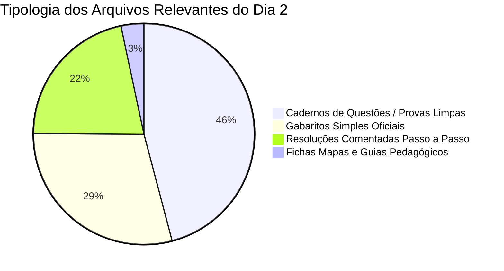

# CATÁLOGO GERAL DO ACERVO DE SIMULADOS E PROVAS: 2º DIA DO ENEM
## Mapeamento Físico, Tipologia Documental e Classificação Estruturada (~5.5 GB)

> **Status:** Concluído — Base Catalogada, Higienizada e Pronta para Execução (Fase 2)  
> **Destino do Arquivo:** `FINAL/CATALOGO_GERAL_ACERVO_ENEM_DIA_2.md`  
> **Cruzamento com Estatística:** Alinhado com `FINAL/RELATORIO_ESTATISTICO_ENEM_DIA_2.md`  

---

## 1. SUMÁRIO EXECUTIVO DO ACERVO

O levantamento exaustivo realizado sobre os diretórios do workspace auditou **1.422 arquivos** totalizando **5,56 GB** de materiais didáticos preparatórios para vestibulares. A análise automatizada identificou os seguintes macroindicadores:

| Métrica Global | Quantidade | Percentual (%) | Descrição Operacional |
| :--- | :---: | :---: | :--- |
| **Total de Arquivos Mapeados** | **1.422** | 100% | Universo total de documentos no workspace |
| **Arquivos Únicos (Desduplicados)** | **1.033** | 72,6% | Conteúdo único expurgando redundâncias |
| **Arquivos Focados no ENEM** | **1.182** | 83,1% | Simulados nacionais e provas oficiais INEP |
| **Materiais Específicos do 2º DIA (STEM)** | **719** | 50,6% | **Cadernos de CN + MAT (Foco estrito desta Fase)** |
| **Materiais Isolados do 1º DIA** | **391** | 27,5% | Linguagens, Ciências Humanas e Redação (Segregados) |
| **Outros Vestibulares / Apoio** | **312** | 21,9% | Olimpíadas SAS, FUVEST, UNICAMP e Fichas Mapas |

---

## 2. SEGREGAÇÃO CRUCIAL: DIA 1 vs DIA 2 E FORMATOS HISTÓRICOS

A segregação do acervo levou em consideração a histórica mudança de matriz promovida pelo INEP no ano de **2017**:

1. **Formato Atual (2017–2026):**
   * **1º Dia:** Linguagens e Códigos + Ciências Humanas + Redação (45 + 45 questões = 90 questões).
   * **2º Dia (Nosso Alvo):** **Ciências da Natureza (Física, Química, Biologia) + Matemática e suas Tecnologias** (45 + 45 questões = 90 questões).
   * Todo o acervo moderno (Bernoulli 2019-2026, SAS 2017-2026, Poliedro 2021-2024, Apeiron 2026 e ENEM Oficial 2017-2025) segue esta exata correspondência.

2. **Formato Histórico Antigo (2009–2016):**
   * **1º Dia Antigo:** Ciências da Natureza + Ciências Humanas (45 + 45 questões).
   * **2º Dia Antigo:** Linguagens e Códigos + Matemática + Redação (45 + 45 questões).
   * **Ação do Catalogador:** Foram catalogados os cadernos de Matemática (do antigo Dia 2) e os cadernos de Natureza (do antigo Dia 1), garantindo que nenhum item histórico de Exatas/Natureza fosse perdido.

---

## 3. DISTRIBUIÇÃO DO ACERVO DIA 2 POR PLATAFORMA / BANCA

| Plataforma / Provedor | Arquivos Dia 2 | Perfil do Acervo e Destaques Pedagógicos |
| :--- | :---: | :--- |
| **Bernoulli Educação** | **281** | Simulados completos de altíssimo padrão técnico para Medicina (2012, 2015, 2019–2026). Destaque para os cadernos de *Gabarito e Questões Comentadas Prova II*, que contêm o enunciado completo acompanhado da resolução passo a passo. Inclui também as *Trilhas Bernoulli* segmentadas por frente. |
| **SAS Plataforma de Educação** | **250** | Simulados Nacionais ENEM SAS (2011, 2017, 2023, 2025, 2026) e vasta coleção de *Avaliações Periódicas (AP2 e AG2 de CNST-MST)* de 2014 a 2021 com resoluções comentadas linha a linha. |
| **INEP (ENEM Oficial)** | **135** | Provas oficiais aplicadas de 2009 a 2025. Inclui todos os cadernos de cores oficiais (Amarelo, Azul, Cinza, Verde, Rosa) e gabaritos definitivos, essenciais para calibragem de padrão de cobrança TRI. |
| **Poliedro Educação** | **47** | Ciclos 2017, 2021, 2022 e a suíte completa de 2024 contendo 5 simulados completos do 2º Dia, provas limpas, cadernos de resolução comentada de 90 páginas e planilhas *Ficha Mapa* com metadados pedagógicos oficiais. |
| **Apeiron** | **6** | Simulados contemporâneos (2026) com cadernos de prova Dia 2 e resolução comentada detalhada oficial (*A2GCD2*). |

---

## 4. CLASSIFICAÇÃO TIPOLÓGICA DOS ARQUIVOS DIA 2

Para maximizar o aproveitamento nos estudos, os 719 arquivos do Dia 2 foram segmentados em 4 categorias funcionais:

1. **Cadernos de Questões (Provas Limpas - ~330 arquivos):**
   * Utilidade: Simulação de prova em tempo real (cronometrada em 5 horas), treino de ritmo, resistência cognitiva e estratégia de preenchimento.
2. **Resoluções Comentadas Passo a Passo (~155 arquivos):**
   * Utilidade: Estudo reverso, diagnóstico de erros, compreensão de distratores e consolidação de métodos de resolução rápida.
3. **Gabaritos Simples Oficiais (~210 arquivos):**
   * Utilidade: Correção instantânea de simulados e conferência rápida de acertos brutos.
4. **Fichas Mapas Pedagógicas (~24 arquivos):**
   * Utilidade: Planilhas estruturadas com mapeamento de cada questão por componente, competência, habilidade da matriz do ENEM e demanda cognitiva (Lembrar, Compreender, Aplicar, Analisar).

---

## 5. TABELA MESTRA DOS PRINCIPAIS SIMULADOS E CADERNOS DIA 2

Abaixo estão listados os principais conjuntos do 2º Dia catalogados no workspace com seus respectivos caminhos de acesso direto e verificados fisicamente:

| Coleção / Edição | Provedor | Ano | Conteúdo e Tipo | Páginas | Caminho Relativo no Workspace |
| :--- | :---: | :---: | :--- | :---: | :--- |
| **Poliedro 2024 Simulado 1** | Poliedro | 2024 | Prova Dia 2 Limpa | 32 | `POLIEDRO/2024/2024_1_poliedro_enem_2_dia_prova.pdf` |
| **Poliedro 2024 Simulado 1 (Resolução)** | Poliedro | 2024 | Resolução Comentada Completa | 91 | `POLIEDRO/2024/1º Simulado Enem 2024 - 2º Dia - Resolução.pdf` |
| **Poliedro 2024 Simulado 1 (Ficha Mapa)** | Poliedro | 2024 | Matriz de Habilidades e Conteúdos | Planilha | `POLIEDRO/2024/1º Simulado Enem 2024 - 2º Dia - Ficha Mapa.xlsx` |
| **Poliedro 2024 Simulado 2** | Poliedro | 2024 | Prova Dia 2 Limpa | 32 | `POLIEDRO/2024/2024_2_poliedro_enem_2_dia_prova.pdf` |
| **Poliedro 2024 Simulado 2 (Resolução)** | Poliedro | 2024 | Resolução Comentada Completa | 88 | `POLIEDRO/2024/2º Simulado Enem 2024 - 2º Dia - Resolução.pdf` |
| **Poliedro 2024 Simulado 3 (Resolução)** | Poliedro | 2024 | Resolução Comentada Completa | 85 | `POLIEDRO/2024/3º Simulado Enem 2024 - 2º Dia - Resolução.pdf` |
| **Poliedro 2024 Simulado 4 (Resolução)** | Poliedro | 2024 | Resolução Comentada Completa | 89 | `POLIEDRO/2024/4º Simulado Enem 2024 - 2º Dia - Resolução.pdf` |
| **Poliedro 2024 Simulado 5 (Resolução)** | Poliedro | 2024 | Resolução Comentada Completa | 87 | `POLIEDRO/2024/5º Simulado Enem 2024 - 2º Dia - Resolução.pdf` |
| **Bernoulli 2019 Simulado 1** | Bernoulli | 2019 | Prova II Limpa | 32 | `BERNOULLI-20261110T151947Z-1-001/BERNOULLI/2019/1º conjunto/1- Segundo dia.pdf` |
| **Bernoulli 2019 Simulado 1 (Comentada)** | Bernoulli | 2019 | Gabarito e Questões Comentadas Prova II | 39 | `BERNOULLI-20261110T151947Z-1-001/BERNOULLI/2019/1º conjunto/Simulado_Enem_2019_Gabarito_e_Questoes_comentadas_Prova_II.pdf` |
| **Bernoulli 2019 Simulado 2 (Comentada)** | Bernoulli | 2019 | Gabarito e Questões Comentadas Prova II | 41 | `BERNOULLI-20261110T151947Z-1-001/BERNOULLI/2019/2º conjunto/2_conj_2019_Gabarito_Questao_comentada_Prova_II.pdf` |
| **Bernoulli 2019 Simulado 3 (Comentada)** | Bernoulli | 2019 | Gabarito e Questões Comentadas Prova II | 40 | `BERNOULLI-20261110T151947Z-1-001/BERNOULLI/2019/3º conjunto/Simulado_Enem_2019_Gabarito_e_Questoes_comentadas_Prova_II.pdf` |
| **Bernoulli 2019 Simulado 4 (Comentada)** | Bernoulli | 2019 | Gabarito e Questões Comentadas Prova II | 42 | `BERNOULLI-20261110T151947Z-1-001/BERNOULLI/2019/4º conjunto/Simulado_Enem_2019_Gabarito_e_Questoes_comentadas_Prova_II.pdf` |
| **Bernoulli 2019 Simulado 5 (Comentada)** | Bernoulli | 2019 | Gabarito e Questões Comentadas Prova II | 38 | `BERNOULLI-20261110T151947Z-1-001/BERNOULLI/2019/5º conjunto/Simulado_Enem_2019_Gabarito_e_Questoes_comentadas_Prova_II.pdf` |
| **Bernoulli 2022 Simulado 1** | Bernoulli | 2022 | Prova Dia 2 Limpa | 32 | `_ENEM_DIA_2_BRUTO/1° BERNOULLI 2022 dia 2.pdf` |
| **Bernoulli 2025 Simulado 1** | Bernoulli | 2025 | Prova Dia 2 Limpa | 32 | `_ENEM_DIA_2_BRUTO/1º BERNOULLI 2025 - D2.pdf` |
| **Bernoulli 2026 Simulado 1 Extra** | Bernoulli | 2026 | Prova Dia 2 Limpa | 32 | `_ENEM_DIA_2_BRUTO/1° BERNOULLI EXTRA 2026 - D2.pdf` |
| **Bernoulli 2026 Book Prova II** | Bernoulli | 2026 | Caderno Completo Prova II | 36 | `_ENEM_DIA_2_BRUTO/d3d4ebf36fc4f39bb474847b5928558207be3c0eBer_SE2026_V05_BOOK_PROVAII.pdf` |
| **SAS Avaliação Periódica 2 (2019)** | SAS | 2019 | Prova Limpa CNST-MST (90Q) | 42 | `_ENEM_DIA_2_BRUTO/1241-19_AP2_CNST-MST_3SERIE_1ETAPA.pdf` |
| **SAS AP2 Resolução Comentada (2019)** | SAS | 2019 | Resolução Completa 1 a 90 | 10 | `_ENEM_DIA_2_BRUTO/1242-19_RESOLUCAO_AP2_CNST-MST_3SERIE_1ETAPA.pdf` |
| **SAS Avaliação Periódica 2 (2020)** | SAS | 2020 | Prova Limpa CNST-MST (90Q) | 43 | `_ENEM_DIA_2_BRUTO/1373-20 - AP2 DE CNST-MST - 3a SERIE - 1a ETAPA _ WILL.pdf` |
| **SAS AP2 Resolução Comentada (2020)** | SAS | 2020 | Resolução Completa 1 a 90 | 12 | `_ENEM_DIA_2_BRUTO/1378-20 - RESOLUCAO - AP2 DE CNST-MST - 3a SERIE - 1a ETAPA _ WILL.pdf` |
| **SAS Avaliação Periódica 2 (2021)** | SAS | 2021 | Prova Limpa CNST-MST (90Q) | 43 | `_ENEM_DIA_2_BRUTO/1139-21 - AP2 DE CNST-MST - 3a SERIE - 1a ETAPA _ WILL.pdf` |
| **SAS AP2 Resolução Comentada (2021)** | SAS | 2021 | Resolução Completa 1 a 90 | 12 | `_ENEM_DIA_2_BRUTO/1452-21 - RESOLUCAO - AP2 DE CNST-MST - 3a SERIE - 1a ETAPA _ WILL.pdf` |
| **SAS Simulado ENEM 2026 D2** | SAS | 2026 | Caderno Amarelo Dia 2 Limpo | 32 | `_ENEM_DIA_2_BRUTO/1º SIMULADO SAS ENEM - 2026 -  D2 - AMARELO.pdf` |
| **SAS Simulado ENEM 2026 D2 (Azul)** | SAS | 2026 | Caderno Azul Dia 2 Limpo | 32 | `_ENEM_DIA_2_BRUTO/1º SIMULADO SAS ENEM - 2026 -  D2 - AZUL .pdf` |
| **Apeiron 2026 Simulado 1** | Apeiron | 2026 | Prova Dia 2 Limpa | 32 | `APEIRON-20261110T152018Z-1-001/APEIRON/2026/1º/1º APEIRON 2026 - D2.pdf` |
| **Apeiron 2026 Simulado 2 (Resolução)** | Apeiron | 2026 | Resolução Comentada Oficial D2 | 90 | `APEIRON-20261110T152018Z-1-001/APEIRON/2º/A2GCD2 (Oficial)-1.pdf` |
| **ENEM Oficial 2024 Dia 2** | INEP | 2024 | Prova Oficial Completa | 32 | `ENEM/2024/ENEM 2024 DIA 2.pdf` |
| **ENEM Oficial 2024 Gabarito** | INEP | 2024 | Gabarito Oficial Definitivo | 2 | `ENEM/2024/GABARITO 2024 DIA 2.pdf` |
| **ENEM Oficial 2025 Dia 2 (Amarelo)** | INEP | 2025 | Caderno Amarelo Dia 2 | 32 | `ENEM/2025/enem-2025-2-dia-caderno-amarelo.pdf` |
| **ENEM Oficial 2025 Dia 2 (Azul)** | INEP | 2025 | Caderno Azul Dia 2 | 32 | `ENEM/2025/enem-2025-2-dia-caderno-azul.pdf` |
| **ENEM Oficial 2025 Dia 2 (Verde)** | INEP | 2025 | Caderno Verde Dia 2 | 32 | `ENEM/2025/enem-2025-2-dia-caderno-verde.pdf` |
| **ENEM Oficial 2025 Dia 2 (Cinza)** | INEP | 2025 | Caderno Cinza Dia 2 | 32 | `ENEM/2025/enem-2025-2-dia-caderno-cinza.pdf` |

---

## 6. PRÓXIMOS PASSOS OPERACIONAIS

Com todo o acervo físico mapeado, classificado e desduplicado:
1. Consulte o arquivo `FINAL/INDICE_TEMATICO_SIMULADOS_DIA_2.md` para navegar pelas questões agrupadas pelos tópicos de alta prioridade da TRI.
2. Consulte o arquivo `FINAL/TRILHA_ESTUDOS_CRONOGRAMA_DIA_2.md` para seguir a trilha tática recomendada de execução dos simulados e simulados diagnósticos.