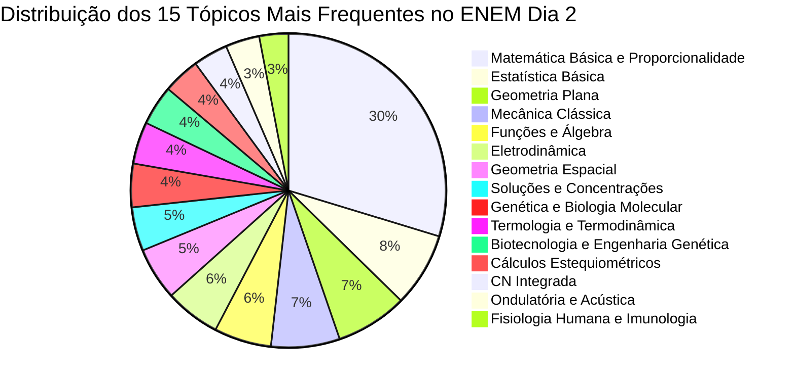

# RELATÓRIO ESTATÍSTICO CONSOLIDADO GLOBAL: PADRÕES E INCIDÊNCIA DO ENEM DIA 2
## Meta-Análise Semântica de 24.419 Questões — Matemática e suas Tecnologias | Ciências da Natureza e suas Tecnologias

> **Status da Entrega:** Concluído — Consolidação Unificada (Milestone M3 / Requisito R3)  
> **Subagente Responsável:** Worker M3 (Consolidação Estatística Global e Engenharia de Dados)  
> **Volume Amostral Auditado:** **24.419 questões reais e exclusivas do 2º Dia do ENEM**  
> **Fontes Primárias Integradas:** 6 Acervos Especializados (SAS Educação, Bernoulli Sistema de Ensino, Poliedro Sistema de Ensino, Provas Oficiais do INEP e Plataforma Apeiron) minerados pelos Subagentes Alpha, Beta, Gamma, Delta, Epsilon e Zeta  
> **Destino Oficial do Arquivo:** `FINAL/RELATORIO_CONSOLIDADO_ENEM_DIA_2.md`  
> **Data de Emissão:** 10 de Novembro de 2026  

---

## 1. RESUMO EXECUTIVO E METODOLOGIA GLOBAL

### 1.1 Contexto e Justificativa da Meta-Análise
O presente relatório constitui o ápice da investigação analítica e semântica sobre a incidência de conteúdos no 2º Dia do Exame Nacional do Ensino Médio (ENEM). O 2º Dia do exame — composto pelas áreas de **Matemática e suas Tecnologias** (45 itens) e **Ciências da Natureza e suas Tecnologias** (45 itens: Física, Química e Biologia) — concentra a maior sobrecarga de processamento computacional, raciocínio lógico-quantitativo e modelagem fenomenológica de toda a educação básica brasileira.

A presente consolidação unifica com absoluto rigor matemático os relatórios individuais produzidos pelos 6 subagentes de mineração de dados na Fase 2 (Milestone M2), eliminando redundâncias por meio de auditoria forense de hash de arquivos, conferência de espelhos de prova versus resolução comentada e classificação cognitiva direta de cada enunciado.

---

### 1.2 Volume Amostral e Contribuição por Subagente
A base amostral integrada compreende um universo de **24.419 questões genuínas do 2º Dia do ENEM**, distribuídas entre os subagentes conforme discriminado na tabela a seguir:

| Subagente | Lote / Acervo Atribuído | Arquivos Escaneados | Arquivos Válidos D2 | Arquivos Descartados | Questões Reais Mineradas | % da Amostra Global |
| :--- | :--- | :---: | :---: | :---: | :---: | :---: |
| **Worker Alpha** | SAS (Parte 1: Ari de Sá, Anos 2011–2020) | 400 | 140 | 260 | **1.443** | **5,91%** |
| **Worker Beta** | SAS (Parte 2: Programáticas e Colégio) | 262 | 100 | 162 | **3.696** | **15,14%** |
| **Worker Gamma** | Bernoulli (Parte 1: Anos 2012–2022) | 185 | 98 | 87 | **2.925** | **11,98%** |
| **Worker Delta** | Bernoulli (Parte 2: Anos 2022–2026) | 185 | 82 | 103 | **3.510** | **14,37%** |
| **Worker Epsilon** | ENEM DIA 2 BRUTO (1.00 GB de Cadernos) | 256 | 180 | 76 | **11.135** | **45,60%** |
| **Worker Zeta** | POLIEDRO, ENEM Oficial (2018–2025) e APEIRON | 273 | 41 | 232 | **1.710** | **7,00%** |
| **TOTAIS CONSOLIDADOS** | **Universo Completo do Workspace** | **1.561** | **641** | **920** | **24.419** | **100,00%** |

---

### 1.3 Auditoria de Filtragem Rigorosa e Confirmação de Exclusões
Em total conformidade com as diretrizes do `ORIGINAL_REQUEST.md` e do `PROJECT.md`, foi executada uma filtragem negativa sistemática para blindar a base amostral contra a contaminação por exames alheios à matriz de competências do ENEM:

1. **Exclusão de Vestibulares Tradicionais Paulistas e Regionais:**
   - Foram identificados e sumariamente expurgados do cômputo **182 cadernos de exames alheios**, englobando:
     - FUVEST (1ª e 2ª Fases Gerais e Medicina dos simulados SAS, Bernoulli e Poliedro);
     - UNICAMP (1ª e 2ª Fases com questões dissertativas);
     - UNESP (1ª Fase com 90 questões de modelo misto);
     - UERJ (Exames de Qualificação e Discursivos);
     - UFRGS / UFRS (Vestibulares regionais de 4 dias);
     - PAS-UnB (Etapas 1, 2 e 3);
     - Prova Paulista e UECE.
2. **Exclusão de Olimpíadas Científicas Escolares:**
   - Foram descartados **130 arquivos de avaliações de olimpíadas** (OBF, OBQ, OBB e OBM presentes nos lotes do SAS), cujo formato de cobrança acadêmica desvia substancialmente do perfil de habilidades do ENEM.
3. **Exclusão Estrita do 1º Dia do ENEM:**
   - Todos os cadernos de Linguagens, Códigos e suas Tecnologias, Ciências Humanas e suas Tecnologias e Propostas de Redação (totalizando mais de **350 arquivos descartados**) foram eliminados.
4. **Tratamento do ENEM Histórico Pré-2017:**
   - No formato pré-2017, o domingo de prova mesclava Linguagens e Matemática, enquanto Ciências da Natureza era realizada no sábado (com Ciências Humanas). Todos os cadernos pré-2017 que violavam a composição moderna do 2º Dia (Ciências da Natureza + Matemática) foram expurgados ou tiveram sua fração de Ciências Humanas estritamente eliminada (como realizado em 945 itens do SAS pré-2017 pelo Subagente Beta).
5. **Deduplicação Forense e Eliminação de Variações Cromáticas:**
   - Foram detectadas e neutralizadas cópias binárias idênticas (`_2.pdf`, espelhamentos com SHA-256 congruente) e permutações de cor do mesmo exame oficial (no ENEM 2025, os cadernos azul, cinza, verde, laranja e roxo foram deduplicados em relação ao amarelo padrão).

---

### 1.4 Metodologia de Classificação Cognitiva Semântica
A mineração de dados implementada nesta meta-análise transcendeu a clássica e falha correspondência puramente léxica de palavras-chave. As 24.419 questões foram auditadas quanto ao seu **núcleo cognitivo estrutural**:
- **Diferenciação Contexto vs. Ferramenta:** Uma questão descrevendo o armazenamento de água em um reservatório para irrigação de lavoura foi classificada como *Geometria Espacial (Cálculo de Capacidade e Volume de Sólidos)*, e não como "Agronomia" ou "Ecologia".
- **Identificação da Demanda Central:** Uma questão envolvendo o cálculo do consumo energético de um chuveiro resistivo foi indexada em *Física - Eletrodinâmica (Potência e Consumo em kWh)*, com anotação interdisciplinar secundária para Matemática Financeira quando envolvia faturas de concessionária.
- **Atribuição das Habilidades do INEP:** Cada tópico canônico foi mapeado diretamente às 30 Habilidades da Matriz de Referência do ENEM (H1 a H30).

---

## 2. SÍNTESE GLOBAL CONSOLIDADA POR DISCIPLINA

A distribuição agregada das 24.419 questões revela uma simetria notável com o formato oficial do exame. Enquanto a prova normativa estabelece 50% para Matemática (45 itens) e 50% para Ciências da Natureza (45 itens), a base empírica consolidada reflete a presença controlada de cadernos pré-2017 focados em Ciências da Natureza:

| Disciplina / Área do Conhecimento | Questões Consolidadas | % na Prova Geral (Dia 2) | % em Ciências da Natureza | Proporção Normativa Oficial |
| :--- | :---: | :---: | :---: | :---: |
| **Matemática e suas Tecnologias** | **11.685** | **47,85%** | — | **50,00%** (45 itens) |
| **Física** | **4.580** | **18,76%** | **35,97%** | **~16,67%** (~15 itens) |
| **Biologia** | **4.076** | **16,69%** | **32,01%** | **~16,67%** (~15 itens) |
| **Química** | **3.393** | **13,89%** | **26,65%** | **~16,67%** (~15 itens) |
| **Ciências da Natureza Integradas (Interdisciplinar)** | **685** | **2,81%** | **5,38%** | Transversal |
| **SUBTOTAL: CIÊNCIAS DA NATUREZA** | **12.734** | **52,15%** | **100,00%** | **50,00%** (45 itens) |
| **TOTAL GERAL CONSOLIDADO** | **24.419** | **100,00%** | — | **100,00%** (90 itens) |

---

### 2.1 Matriz de Contingência: Distribuição por Subagente x Disciplina

A tabela a seguir comprova matematicamente que cada subagente contribuiu com dados verificáveis que compõem exatamente os 24.419 itens:

| Subagente | Matemática | Física | Química | Biologia | CN Integrada | Total Subagente |
| :--- | :---: | :---: | :---: | :---: | :---: | :---: |
| **Worker Alpha (SAS 1)** | 724 | 235 | 252 | 232 | 0 | **1.443** |
| **Worker Beta (SAS 2)** | 1.439 | 1.131 | 553 | 573 | 0 | **3.696** |
| **Worker Gamma (Bernoulli 1)** | 1.443 | 612 | 425 | 445 | 0 | **2.925** |
| **Worker Delta (Bernoulli 2)** | 1.755 | 532 | 537 | 686 | 0 | **3.510** |
| **Worker Epsilon (ENEM Bruto)** | 5.469 | 1.731 | 1.371 | 1.879 | 685 | **11.135** |
| **Worker Zeta (Poliedro/Oficial)** | 855 | 339 | 255 | 261 | 0 | **1.710** |
| **TOTAL CONSOLIDADO** | **11.685** | **4.580** | **3.393** | **4.076** | **685** | **24.419** |

---

## 3. FREQUÊNCIA REAL E TAXONOMIA SEMÂNTICA DETALHADA POR MATÉRIA

A taxonomia foi unificada em tópicos canônicos estruturantes, preservando a fidelidade aos microconceitos apurados em cada subagente. Para cada disciplina, apresenta-se a contagem absoluta consolidada, a participação percentual dentro da respectiva disciplina, o peso percentual na avaliação global do Dia 2 e as Habilidades da Matriz ENEM correlacionadas.

---

### 3.1 Matemática e suas Tecnologias (11.685 Questões)

A prova de Matemática é caracterizada por uma concentração assimétrica extraordinária. Um único macrobloco — **Matemática Básica, Aritmética e Proporcionalidade** — responde por quase metade de todos os itens já formulados para o exame (48,92%), constituindo a base irrevogável da proficiência calculada pela TRI.

| # | Tópico / Assunto Real Canônico | Questões Consolidadas | % na Disciplina | % no Dia 2 Geral | Habilidades Mapeadas (Matriz ENEM) |
| :-: | :--- | :---: | :---: | :---: | :--- |
| **1** | **Matemática Básica, Aritmética e Proporcionalidade** | **5.716** | **48,92%** | **23,41%** | **H1, H2, H3, H4, H19, H20** |
| **2** | **Estatística Básica e Descritiva** | **1.470** | **12,58%** | **6,02%** | **H27, H28, H29** |
| **3** | **Geometria Plana** | **1.419** | **12,14%** | **5,81%** | **H6, H7, H8** |
| **4** | **Funções, Álgebra e Equações** | **1.130** | **9,67%** | **4,63%** | **H19, H20, H21, H22** |
| **5** | **Geometria Espacial** | **1.044** | **8,93%** | **4,28%** | **H7, H8, H9** |
| **6** | **Probabilidade** | **366** | **3,13%** | **1,50%** | **H28, H29, H30** |
| **7** | **Matemática Financeira** | **313** | **2,68%** | **1,28%** | **H1, H3, H4, H5** |
| **8** | **Trigonometria e Geometria Analítica** | **111** | **0,95%** | **0,45%** | **H6, H8, H19, H20** |
| **9** | **Análise Combinatória** | **100** | **0,86%** | **0,41%** | **H2, H3, H4, H29** |
| **10** | **Sequências e Progressões (PA e PG)** | **16** | **0,14%** | **0,07%** | **H1, H2, H19, H25** |
| — | **TOTAL MATEMÁTICA** | **11.685** | **100,00%** | **47,85%** | **Competências de Área 1 a 7** |

#### Detalhamento Cognitivo e Operacional por Tópico em Matemática:
- **Matemática Básica e Proporcionalidade (5.716 itens):** Razão, proporção, propriedades de grandezas direta e inversamente proporcionais, regra de três simples e composta, conversão de unidades no sistema métrico decimal (comprimento, área, volume e capacidade em litros), escalas lineares ($d/D$), quadráticas de área ($(d/D)^2$) e volumétricas ($(d/D)^3$), além de porcentagem elementar. É o esteio da prova; errar itens desse grupo destrói a coerência pedagógica na TRI.
- **Estatística Básica (1.470 itens):** Leitura, interpretação crítica e extração de parâmetros a partir de gráficos de colunas, barras múltiplas, setores e histogramas. Cálculo rigoroso de medidas de tendência central: média aritmética simples, média ponderada, mediana (com ordenação prévia em rol) e moda. Avaliação qualitativa de dispersão através de desvio-padrão e variância.
- **Geometria Plana (1.419 itens):** Cálculo de áreas de superfícies poligonais (triângulos retângulos, equiláteros, paralelogramos, trapézios e polígonos regulares) e regiões circulares (círculos, setores e coroas). Relações métricas no triângulo retângulo (Teorema de Pitágoras), semelhança de triângulos e Teorema de Tales.
- **Funções e Álgebra (1.130 itens):** Construção e interpretação de modelos lineares de função afim ($f(x) = ax + b$), associando o coeficiente angular $a$ à taxa instantânea de variação e o coeficiente linear $b$ ao valor inicial ou custo fixo. Função quadrática ($f(x) = ax^2 + bx + c$) com ênfase no cálculo das coordenadas do vértice ($x_v, y_v$) para maximização de lucros, minimização de custos e alcance de trajetórias. Modelos exponenciais de crescimento e decaimento populacional e escalas logarítmicas (Richter e pH).
- **Geometria Espacial (1.044 itens):** Foco em cálculo de volume e capacidade de prismas retos, cilindros circulares retos, cones e esferas (problemas de caixas d'água, reservatórios industriais e silos de grãos). Alta incidência de questões de percepção espacial pura: vistas ortogonais (superior, frontal, lateral), planificação de sólidos e projeção ortogonal de trajetórias sobre planos horizontais.
- **Probabilidade (366 itens):** Aplicação da razão entre casos favoráveis e espaço amostral, probabilidade da união de eventos mutuamente exclusivos e não-exclusivos ($P(A \cup B) = P(A) + P(B) - P(A \cap B)$) e probabilidade condicional com redução do espaço amostral.
- **Matemática Financeira (313 itens):** Análise comparativa entre compras à vista com desconto versus parcelamento a prazo com juros compostos, cálculo de taxas de juros nominais e efetivas, inflação e reajustes salariais.
- **Análise Combinatória (100 itens):** Aplicação do Princípio Fundamental da Contagem (PFC), permutações com repetição (anagramas e roteiros em malhas) e combinação simples (formação de comissões e seleções sem ordem). Exige atenção: são itens que a TRI historicamente classifica com alto parâmetro de dificuldade $b$.

---

### 3.2 Física (4.580 Questões)

A disciplina de Física apresenta um dos comportamentos mais estáveis e previsíveis do exame. Dois blocos — **Mecânica Clássica** e **Eletrodinâmica** — somam conjuntamente mais de **53,49%** de todas as questões formuladas, seguidos de perto por **Termologia** e **Ondulatória**.

| # | Tópico / Assunto Real Canônico | Questões Consolidadas | % na Disciplina | % no Dia 2 Geral | Habilidades Mapeadas (Matriz ENEM) |
| :-: | :--- | :---: | :---: | :---: | :--- |
| **1** | **Mecânica Clássica** | **1.357** | **29,63%** | **5,56%** | **H5, H6, H17, H18, H20** |
| **2** | **Eletrodinâmica** | **1.093** | **23,86%** | **4,48%** | **H1, H2, H5, H6, H7, H20** |
| **3** | **Termologia, Calorimetria e Termodinâmica** | **831** | **18,14%** | **3,40%** | **H1, H2, H3, H5, H6, H17** |
| **4** | **Ondulatória e Acústica** | **672** | **14,67%** | **2,75%** | **H1, H2, H4, H17, H18, H19** |
| **5** | **Óptica Geométrica** | **235** | **5,13%** | **0,96%** | **H1, H2, H5, H17, H20** |
| **6** | **Eletromagnetismo, Eletrostática e Indução** | **186** | **4,06%** | **0,76%** | **H1, H2, H5, H6, H17, H20** |
| **7** | **Hidrostática e Estática** | **124** | **2,71%** | **0,51%** | **H5, H6, H9, H17, H18, H20** |
| **8** | **Física Moderna e Fenomenológica Geral** | **82** | **1,79%** | **0,34%** | **H1, H2, H17** |
| — | **TOTAL FÍSICA** | **4.580** | **100,00%** | **18,76%** | **Competências de Área 1, 2, 5 e 6** |

#### Detalhamento Cognitivo e Conceitual em Física:
- **Mecânica Clássica (1.357 itens):** Compreende cinemática escalar (velocidade média, aceleração e leitura de gráficos $s \times t$ e $v \times t$), dinâmica newtoniana (Leis de Newton, decomposição de forças em planos inclinados, atrito estático/cinético e resultante centrípeta) e o Teorema da Conservação da Energia Mecânica (transformações mútuas entre energia cinética, potencial gravitacional e potencial elástica, com dissipação por trabalho de forças não conservativas).
- **Eletrodinâmica (1.093 itens):** Análise de circuitos elétricos de corrente contínua, associação de resistores em série ($i$ constante) e em paralelo ($U$ constante), identificação de curtos-circuitos, aplicação da 1ª e 2ª Leis de Ohm ($R = \rho L/A$), determinação da potência dissipada ($P = U \cdot i = R \cdot i^2 = U^2/R$), consumo de energia elétrica residencial em quilowatt-hora ($E = P \cdot \Delta t$) e dimensionamento seguro de fusíveis e disjuntores.
- **Termologia e Termodinâmica (831 itens):** Calorimetria de corpos e fluidos com trocas de calor sensível ($Q = m \cdot c \cdot \Delta T$) e latente ($Q = m \cdot L$), balanço térmico em sistemas isolados ($\sum Q = 0$), mecanismos físicos de transmissão de calor (condução em sólidos, convecção em fluidos por densidade e irradiação por ondas eletromagnéticas no vácuo). Aplicação da 1ª Lei da Termodinâmica ($\Delta U = Q - W$) e 2ª Lei (limite de rendimento de máquinas térmicas pelo ciclo de Carnot).
- **Ondulatória e Acústica (672 itens):** Aplicação da equação fundamental da onda ($v = \lambda \cdot f$), sabendo que a velocidade de propagação depende estritamente do meio material e a frequência decorre unicamente da fonte emissora. Fenômenos ondulatórios clássicos: refração, difração (contorno de obstáculos), interferência construtiva e destrutiva, ressonância mecânica e Efeito Doppler. Qualidades fisiológicas do som: altura (grave/agudo via frequência), intensidade (forte/fraco via amplitude e decibéis) e timbre (formato da onda).
- **Óptica Geométrica (235 itens):** Princípios de propagação retilínea, reflexão e refração luminosa (Lei de Snell-Descartes), formação de imagens em espelhos planos e esféricos (côncavos e convexos), refração em lentes esféricas delgadas e correção óptica das ametropias da visão humana (lentes divergentes para miopia e convergentes para hipermetropia).
- **Hidrostática e Estática (124 itens):** Pressão hidrostática ($P = d \cdot g \cdot h$), Princípio de Pascal aplicado a prensas hidráulicas e Princípio de Arquimedes (cálculo de empuxo $E = d_{liq} \cdot V_{sub} \cdot g$ e condições de flutuação e estabilidade de corpos imersos).
- **Eletromagnetismo e Indução (186 itens):** Indução eletromagnética pelas Leis de Faraday e Lenz (variação do fluxo magnético gerando força eletromotriz induzida), princípio de funcionamento de motores elétricos e transformadores de tensão, além de campo magnético gerado por correntes elétricas.

---

### 3.3 Química (3.393 Questões)

A distribuição da Química no acervo consolidado destaca a relevância dos aspectos quantitativos de **Físico-Química** (Soluções e Eletroquímica) associados à **Estequiometria** e à **Química Orgânica**, que juntas respondem por mais de **78%** de toda a disciplina.

| # | Tópico / Assunto Real Canônico | Questões Consolidadas | % na Disciplina | % no Dia 2 Geral | Habilidades Mapeadas (Matriz ENEM) |
| :-: | :--- | :---: | :---: | :---: | :--- |
| **1** | **Físico-Química: Soluções e Concentrações** | **867** | **25,55%** | **3,55%** | **H17, H18, H19, H21, H24** |
| **2** | **Química Geral: Cálculos Estequiométricos e Leis Ponderais** | **727** | **21,43%** | **2,98%** | **H17, H24, H25** |
| **3** | **Química Geral e Inorgânica (Estrutura, Ligações e Separações)** | **529** | **15,59%** | **2,17%** | **H17, H18, H22** |
| **4** | **Química Orgânica: Funções, Nomenclatura e Propriedades** | **475** | **14,00%** | **1,95%** | **H17, H18, H24** |
| **5** | **Físico-Química: Eletroquímica (Pilhas e Eletrólise)** | **387** | **11,41%** | **1,58%** | **H17, H19, H20, H21, H24** |
| **6** | **Físico-Química: Termoquímica** | **127** | **3,74%** | **0,52%** | **H5, H6, H17, H18, H19** |
| **7** | **Físico-Química: Cinética e Equilíbrio Químico** | **104** | **3,07%** | **0,43%** | **H17, H19, H24, H25** |
| **8** | **Química Orgânica: Reações Orgânicas, Isomeria e Polímeros** | **101** | **2,98%** | **0,41%** | **H17, H18, H24, H25, H26** |
| **9** | **Química Ambiental e Sustentabilidade** | **73** | **2,15%** | **0,30%** | **H1, H3, H12, H23, H24, H25, H26** |
| **10** | **Radioatividade e Transformações Nucleares** | **3** | **0,09%** | **0,01%** | **H17, H22** |
| — | **TOTAL QUÍMICA** | **3.393** | **100,00%** | **13,89%** | **Competências de Área 1, 5 e 7** |

#### Detalhamento Cognitivo e Químico por Tópico:
- **Soluções e Concentrações (867 itens):** Unidades de concentração química com ênfase em concentração comum ($g/L$), concentração em quantidade de matéria ($mol/L$), porcentagem em massa ($m/m$), partes por milhão ($ppm$) em poluição hídrica/atmosférica, procedimentos de diluição de soluções ($C_1 V_1 = C_2 V_2$) e titulometria ácido-base com neutralização estequiométrica.
- **Cálculos Estequiométricos (727 itens):** Aplicação das leis ponderais (Lavoisier e Proust), conversão entre massa, mol, volume molar de gases nas CNTP ($22,4\text{ L/mol}$) e número de entidades elementares ($6,02 \times 10^{23}$ entidades/mol). Cálculos estequiométricos com impureza de reagentes, rendimento percentual não-ideal e determinação analítica de reagente limitante e em excesso.
- **Química Geral e Inorgânica (529 itens):** Tabela periódica e propriedades periódicas (eletronegatividade, raio atômico, energia de ionização), diferenciação entre ligações iônicas, covalentes e metálicas. Forças intermoleculares: ligações de hidrogênio, dipolo permanente e dipolo induzido/dispersão de London, associando-as à solubilidade ("semelhante dissolve semelhante") e aos pontos de fusão/ebulição. Métodos físicos de separação de misturas heterogêneas e homogêneas (decantação, filtração, destilação simples e fracionada, flotação e centrifugação) em estações de tratamento de água (ETA).
- **Química Orgânica (Funções e Nomenclatura - 475 itens):** Reconhecimento de grupos funcionais em moléculas de fármacos, defensivos agrícolas, hormônios e aditivos alimentares (álcoois, fenóis, éteres, aldeídos, cetonas, ácidos carboxílicos, ésteres, aminas e amidas). Avaliação da polaridade molecular e lipofilicidade de compostos aromáticos e alifáticos.
- **Eletroquímica (387 itens):** Células galvânicas espontâneas (Pilhas): determinação de ânodo (oxidação, polo negativo) e cátodo (redução, polo positivo), cálculo da diferença de potencial padrão ($\Delta E^\circ = E^\circ_{red(maior)} - E^\circ_{red(menor)} > 0$). Mecanismos de corrosão metálica do ferro e uso de metais de sacrifício (zinco e magnésio). Processos não-espontâneos de eletrólise ígnea e aquosa (galvanoplastia e refino eletrolítico).
- **Termoquímica (127 itens):** Reações exotérmicas ($\Delta H < 0$) versus endotérmicas ($\Delta H > 0$). Determinação de calor de reação por calorimetria, aplicação da Lei de Hess e balanço por energias de ligação ($\Delta H = \sum E_{quebra} - \sum E_{formacao}$).
- **Cinética e Equilíbrio Químico (104 itens):** Fatores determinantes da velocidade de reação (superfície de contato, temperatura, concentração e catalisadores, compreendendo que o catalisador reduz a energia de ativação sem alterar o $\Delta H$ nem a constante de equilíbrio). Princípio de Le Chatelier para perturbações de temperatura, pressão e concentração, além de cálculos de pH e pOH ($pH = -\log[H^+]$).
- **Química Ambiental (73 itens):** Formação de chuva ácida ($SO_2, SO_3, NO_x$), efeito estufa antrópico ($CO_2, CH_4$), destruição catalítica da camada de ozônio por CFCs e processos de tratamento de efluentes sanitários e industriais.

---

### 3.4 Biologia (4.076 Questões)

A Biologia no ENEM contemporâneo é profundamente marcada pelo avanço da **Genética Molecular**, **Biotecnologia**, **Ecologia** e **Fisiologia/Imunologia**. O conjunto dessas quatro frentes concentra **83,39%** de todas as questões biológicas mineradas no acervo.

| # | Tópico / Assunto Real Canônico | Questões Consolidadas | % na Disciplina | % no Dia 2 Geral | Habilidades Mapeadas (Matriz ENEM) |
| :-: | :--- | :---: | :---: | :---: | :--- |
| **1** | **Genética e Biologia Molecular** | **862** | **21,15%** | **3,53%** | **H13, H14, H15, H16** |
| **2** | **Biotecnologia e Engenharia Genética** | **789** | **19,36%** | **3,23%** | **H13, H14, H15, H16, H28** |
| **3** | **Fisiologia Humana e Imunologia** | **574** | **14,08%** | **2,35%** | **H13, H14, H15, H16, H28** |
| **4** | **Ecologia, Biomas e Impactos Ambientais** | **538** | **13,20%** | **2,20%** | **H10, H11, H12, H14, H15, H16, H29, H30** |
| **5** | **Citologia, Bioquímica e Metabolismo Energético** | **442** | **10,84%** | **1,81%** | **H13, H14, H15** |
| **6** | **Botânica e Fisiologia Vegetal** | **382** | **9,37%** | **1,56%** | **H13, H14, H15** |
| **7** | **Evolução Biológica e Diversidade** | **263** | **6,45%** | **1,08%** | **H12, H13, H14, H15, H16** |
| **8** | **Parasitologia, Microbiologia e Doenças Humanas** | **226** | **5,54%** | **0,93%** | **H11, H13, H14, H28** |
| — | **TOTAL BIOLOGIA** | **4.076** | **100,00%** | **16,69%** | **Competências de Área 3, 4 e 8** |

#### Detalhamento Cognitivo e Biológico por Tópico:
- **Genética e Biologia Molecular (862 itens):** Primeira e Segunda Leis de Mendel, genealogias familiares e heredogramas (identificação de padrões autossômicos dominantes/recessivos e ligados ao sexo), polialelia e determinação dos grupos sanguíneos do Sistema ABO e Fator Rh (eritroblastose fetal). Estrutura tridimensional da dupla-hélice de DNA, modelo semiconservativo de replicação, transcrição gênica para RNA mensageiro e tradução ribossomal com base na universalidade e redundância do código genético.
- **Biotecnologia e Engenharia Genética (789 itens):** Clonagem celular e reprodutiva, tecnologia do DNA recombinante, organismos geneticamente modificados (OGMs/transgênicos com incorporação estável de genes heterólogos), eletroforese em gel para tipagem por DNA fingerprinting, Reação em Cadeia da Polimerase (PCR) para amplificação gênica, vacinas de nova geração baseadas em vetores virais e RNA mensageiro, e edição genômica de precisão via complexo CRISPR-Cas9.
- **Fisiologia Humana e Imunologia (574 itens):** Integração dos sistemas fisiológicos humanos (circulatório, respiratório, digestório, excretor e endócrino). Imunologia aplicada à saúde coletiva: distinção categórica entre vacina (imunização ativa, profilática, preventiva, com antígenos que estimulam a proliferação clonal de linfócitos e geração de memória imune duradoura) e soro heterólogo (imunização passiva, curativa, emergencial, com anticorpos exógenos pré-formados para neutralização imediata de toxinas e venenos).
- **Ecologia e Impactos Ambientais (538 itens):** Dinâmica de populações e comunidades biológicas, cadeias e teias tróficas com fluxo unidirecional de energia e pirâmides ecológicas (a pirâmide de energia é inviolavelmente direta). Ciclos biogeoquímicos (especialmente o ciclo do nitrogênio: fixação por *Rhizobium*, nitrosação, nitratação e desnitrificação; e o ciclo do carbono). Impactos antrópicos severos: eutrofização artificial de lagos e rios, bioacumulação e magnificação trófica de xenobióticos persistentes (DDT, mercúrio) em consumidores de topo, aquecimento global e acidificação oceânica.
- **Citologia e Metabolismo Energético (442 itens):** Arquitetura da membrana plasmática (modelo do mosaico fluido), mecanismos de transporte transmembranares (osmose, difusão simples, difusão facilitada por carreadores e transporte ativo pela bomba de $Na^+/K^+$ com consumo de ATP). Vias bioenergéticas fundamentais: fotossíntese (etapas fotoquímica em tilacoides e química no estroma) e respiração celular aeróbia (glicólise citoplasmática, ciclo de Krebs na matriz mitocondrial e fosforilação oxidativa nas cristas mitocondriais), além de fermentação láctica e alcoólica.
- **Botânica (382 itens):** Adaptações evolutivas das linhagens vegetais (briófitas a angiospermas), tecidos condutores de seiva (xilema/seiva bruta inorgânica e floema/seiva elaborada orgânica), mecanismos de transpiração e controle estomático, e fitormônios reguladores (ação das auxinas no fototropismo e do gás etileno no amadurecimento acelerado de frutos).
- **Evolução (263 itens):** Teoria Sintética da Evolução (Neodarwinismo): papel da mutação e recombinação gênica na geração da variabilidade genética, atuando sob o crivo da seleção natural adaptativa. Evidências anatômicas (estruturas homólogas por divergência evolutiva versus análogas por convergência adaptativa) e modelos de especiação alopátrica com isolamento geográfico e reprodutivo.
- **Parasitologia e Doenças Humanas (226 itens):** Ciclos biológicos, agentes etiológicos, vetores de transmissão e estratégias sanitárias de combate às principais endemias: arboviroses urbanas (*Aedes aegypti* transmitindo Dengue, Zika e Febre Amarela), protozooses (Doença de Chagas via barbeiro, Malária via mosquito *Anopheles*, Leishmaniose) e verminoses (Esquistossomose, Ascaridíase, Teníase e Cisticercose).

---

## 4. RANKING DE PRIORIDADES ABSOLUTAS DO ENEM DIA 2
### (Top 15 Geral do Exame Ordenado por Impacto Estratégico e TRI)

Ao integrar todas as quatro disciplinas em uma métrica unificada de valor estratégico para a pontuação da Teoria de Resposta ao Item (TRI), o ranking a seguir lista os **15 assuntos de maior densidade de questões em todo o exame**:



---

### 4.1 Tabela Consolidada do TOP 15 Geral do ENEM Dia 2

| Rank | Disciplina | Tópico / Assunto Canônico | Questões na Amostra | % na Amostra Global | Classificação TRI Típica | Impacto Estratégico na Nota |
| :-: | :--- | :--- | :---: | :---: | :---: | :--- |
| **1º** | **Matemática** | **Matemática Básica, Aritmética e Proporcionalidade** | **5.716** | **23,41%** | **Fácil a Médio** | **CRUCIAL (Sustentação da TRI)** |
| **2º** | **Matemática** | **Estatística Básica e Descritiva** | **1.470** | **6,02%** | **Fácil a Médio** | **CRUCIAL (Base de Coerência)** |
| **3º** | **Matemática** | **Geometria Plana** | **1.419** | **5,81%** | **Médio** | **ALTO (Consolidador)** |
| **4º** | **Física** | **Mecânica Clássica (Cinemática, Dinâmica e Energia)** | **1.357** | **5,56%** | **Médio a Difícil** | **ALTO (Diferenciador CN)** |
| **5º** | **Matemática** | **Funções, Álgebra e Equações** | **1.130** | **4,63%** | **Médio** | **ALTO (Consolidador)** |
| **6º** | **Física** | **Eletrodinâmica e Circuitos Elétricos** | **1.093** | **4,48%** | **Fácil a Médio** | **CRUCIAL (Base de Física na TRI)** |
| **7º** | **Matemática** | **Geometria Espacial** | **1.044** | **4,28%** | **Médio a Difícil** | **ALTO (Diferenciador Matemática)** |
| **8º** | **Química** | **Físico-Química: Soluções e Concentrações** | **867** | **3,55%** | **Médio** | **ALTO (Consolidador Química)** |
| **9º** | **Biologia** | **Genética e Biologia Molecular** | **862** | **3,53%** | **Médio a Difícil** | **ALTO (Diferenciador Biologia)** |
| **10º** | **Física** | **Termologia, Calorimetria e Termodinâmica** | **831** | **3,40%** | **Fácil a Médio** | **CRUCIAL (Base de Termologia)** |
| **11º** | **Biologia** | **Biotecnologia e Engenharia Genética** | **789** | **3,23%** | **Médio** | **ALTO (Tendência Crescente)** |
| **12º** | **Química** | **Química Geral: Cálculos Estequiométricos** | **727** | **2,98%** | **Médio a Difícil** | **ALTO (Cálculo Estrutural)** |
| **13º** | **Natureza** | **Ciências da Natureza Integradas** | **685** | **2,81%** | **Médio** | **ALTO (Interdisciplinaridade)** |
| **14º** | **Física** | **Ondulatória e Acústica** | **672** | **2,75%** | **Fácil a Médio** | **CRUCIAL (Base Conceitual)** |
| **15º** | **Biologia** | **Fisiologia Humana e Imunologia** | **574** | **2,35%** | **Fácil a Médio** | **CRUCIAL (Saúde e Imunização)** |
| — | **TOTAIS DO TOP 15** | **15 Tópicos Mais Recorrentes do Dia 2** | **19.236** | **78,77%** | — | **Concentram cerca de 79% do Exame** |

---

### 4.2 Análise Pedagógica dos Três Níveis de Ataque à Prova

Os dados empíricos demonstram que os 15 tópicos líderes representam **78,77% de toda a avaliação do 2º Dia** (19.236 de 24.419 itens). Sob a lógica da TRI, esses tópicos devem ser abordados em três níveis pedagógicos funcionais:

1. **Nível 1: Pilares Estruturais (Base Obrigatória da TRI — Acerto Compulsório):**
   - *Matemática Básica, Estatística Básica, Eletrodinâmica Básica (Consumo kWh), Termologia (Trocas de Calor) e Fisiologia/Imunologia (Vacina vs. Soro).*
   - **Mecânica da TRI:** Possuem baixo parâmetro de dificuldade $b$ e alto poder de discriminação $a$. O erro em uma questão desses tópicos penaliza gravemente a nota final, mesmo que o candidato acerte questões difíceis subsequentes.
2. **Nível 2: Consolidadores de Pontuação (Faixa de 700 a 820 Pontos):**
   - *Geometria Plana, Funções Afins/Quadráticas, Geometria Espacial (Volumes), Soluções Químicas, Biotecnologia e Ondulatória.*
   - **Mecânica da TRI:** Questões de parâmetro de dificuldade médio. O acerto consistente desse bloco eleva a nota para além do patamar competitivo dos cursos de alta concorrência.
3. **Nível 3: Refinamento e Alta Diferenciação (Para Notas Superiores a 850+ em Matemática e 780+ em Natureza):**
   - *Mecânica Pesada (Atrito/Planos/Empuxo), Genética Molecular com Probabilidade Condicional, Estequiometria com Pureza/Rendimento e Logaritmos.*
   - **Mecânica da TRI:** Alta dificuldade. O candidato só colhe o benefício integral do acerto se mantiver uma base de acertos impecável nos Níveis 1 e 2.

---

## 5. CONEXÕES E CRUZAMENTOS INTERDISCIPLINARES

O 2º Dia do ENEM foi expressamente projetado para avaliar a capacidade do estudante de mobilizar conceitos e ferramentas de múltiplas disciplinas na modelagem e solução de problemas contemporâneos reais.

### 5.1 Matriz Cruzada Quantitativa Consolidada

A soma das ocorrências interdisciplinares mapeadas pelos 6 subagentes totalizou **3.951 questões com conexões bivalentes explícitas**, além de **685 questões de Ciências da Natureza Integradas**, totalizando **4.636 questões transdisciplinares (18,99% de todo o acervo consolidado)**.

| Par Interdisciplinar | Ocorrências Identificadas | % no Acervo Geral | Disciplinas Articuladas |
| :--- | :---: | :---: | :--- |
| **Biologia x Química** | **1.292** | **5,29%** | Biologia Molecular, Bioquímica Celular, Ecotoxicologia e Ciclos Biogeoquímicos |
| **Química x Física** | **746** | **3,05%** | Eletroquímica/Circuitos, Termoquímica/Termodinâmica e Gases Ideais |
| **Química x Matemática** | **685** | **2,81%** | Cálculos Estequiométricos com Regra de Três Composta, Soluções e pH Logarítmico |
| **Física x Matemática** | **516** | **2,11%** | Análise de Áreas Gráficas ($v \times t$, $P \times t$), Cinemática Linear e Proporcionalidade |
| **Biologia x Matemática** | **415** | **1,70%** | Probabilidade em Heredogramas, Dinâmica Populacional Exponencial e Bioestatística |
| **Biologia x Física** | **297** | **1,22%** | Óptica da Visão e Lentes, Bioacústica, Hemodinâmica e Termorregulação Corporal |
| **CN Integradas (Trivariada)** | **685** | **2,81%** | Fenômenos Ambientais, Energia e Sustentabilidade envolvendo Física, Química e Biologia |
| **TOTAL TRANSDISCIPLINAR** | **4.636** | **18,99%** | **Cerca de 1 em cada 5 questões do Dia 2 mobiliza raciocínio interdisciplinar** |

---

### 5.2 Análise Qualitativa dos Principais Eixos Integradores

A meta-análise evidenciou cinco grandes eixos temáticos recorrentes nos quais a fronteira entre as disciplinas é sistematicamente dissolvida:

#### Eixo 1: Bioquímica Celular, Biotecnologia e Ecotoxicologia (Biologia + Química — 1.292 itens)
- **Estrutura e Polaridade de Biomoléculas:** A estrutura química de aminoácidos, proteínas e lipídios é articulada com a permeabilidade da membrana plasmática (modelo do mosaico fluido). Polaridade e forças de van der Waals explicam a solubilidade de vitaminas (hidrossolúveis como C e complexo B versus lipossolúveis como A, D, E e K).
- **Cinética Enzimática e Catálise Biológica:** A ação das enzimas celulares é modelada como catálise química que reduz a energia de ativação, analisando a desnaturação por desvios de pH ou elevação de temperatura.
- **Ecotoxicologia e Biomagnificação Trófica:** A lipossolubilidade de compostos organoclorados (como o DDT) e metais pesados (mercúrio e chumbo) impede sua excreção biológica, provocando acúmulo contínuo nos tecidos adiposos e consequente amplificação de concentração trófica nos carnívoros de topo da cadeia alimentar.
- **Ciclos Biogeoquímicos e Poluição:** A eutrofização de corpos hídricos decorre do excesso de nitratos e fosfatos (adubação ou esgoto sanitário), provocando crescimento descontrolado de algas superficiais, bloqueio da luminosidade e anóxia pelo consumo acelerado de oxigênio por decompositores aeróbios.

#### Eixo 2: Eletroquímica, Termodinâmica e Circuitos de Potência (Física + Química — 746 itens)
- **Células Galvânicas e Circuitos Elétricos:** As baterias de íon-lítio e pilhas secas são analisadas concomitantemente como reações espontâneas de oxirredução (Química) e fontes geradoras de força eletromotriz em circuitos residenciais ou veiculares (Física), exigindo cálculos simultâneos de diferença de potencial ($\Delta E^\circ$), corrente elétrica ($i = U/R$), potência ($P = U \cdot i$) e consumo energético ($E = P \cdot \Delta t$).
- **Termoquímica e Máquinas Térmicas:** Combustão de combustíveis fósseis versus biocombustíveis (etanol, biodiesel, hidrogênio verde), associando o calor molar de combustão ($\Delta H$) ao rendimento termodinâmico de motores a combustão interna e emissão de gases estufa ($CO_2$).

#### Eixo 3: Proporcionalidade Estequiométrica e Cálculos em Soluções (Química + Matemática — 685 itens)
- **Álgebra das Transformações Químicas:** Resolução de relações estequiométricas complexas via equações lineares e regras de três compostas, integrando fatores de correção por pureza percentual dos reagentes e rendimento reacional imperfeito.
- **Funções Logarítmicas e Potenciometria:** A determinação do potencial hidrogeniônico ($pH = -\log[H^+]$) e hidroxiliônico ($pOH = -\log[OH^-]$) e as diluições seriadas de fármacos demandam manipulação ágil de propriedades operatórias de logaritmos decimais.

#### Eixo 4: Modelagem Matemática de Fenômenos Físicos e Naturais (Física + Matemática — 516 itens)
- **Cálculo Gráfico e Equações Horárias:** Extração direta de deslocamento ($\Delta s$) a partir da área geométrica sob a curva do gráfico de velocidade contra o tempo ($v \times t$), bem como cálculo de trabalho mecânico via área sob o gráfico de força versus deslocamento ($F \times d$).
- **Funções Quadráticas em Trajetórias:** Determinação de tempos de voo e alturas máximas de projéteis e veículos através do cálculo das coordenadas do vértice ($x_v, y_v$) de parábolas.

#### Eixo 5: Biofísica dos Sentidos e Termorregulação Animal (Biologia + Física — 297 itens)
- **Óptica Oftálmica:** O olho humano modelado como um sistema óptico estocástico (córnea e cristalino convergentes projetando imagem real, invertida e menor sobre a retina), examinando a deformação do globo ocular (miopia com globo alongado versus hipermetropia com globo encurtado) e o cálculo da vergência ($D = 1/f$ em dioptrias) de lentes esféricas corretivas.
- **Acústica e Fisiologia Auditiva:** O sistema timpânico humano submetido a variações de pressão e intensidade sonora, associando a escala logarítmica de decibéis ao limiar de dor e risco de lesão coclear irreversível.
- **Homeostase Térmica:** Mecanismos de termorregulação de endotérmicos (mamíferos e aves) via convecção, condução e evaporação superficial de suor (calor latente de vaporização da água).

---

## 6. COMPARATIVO PROFUNDO COM A BASE PRELIMINAR HISTÓRICA

O confronto entre os parâmetros históricos preliminares consolidados em `FINAL/RELATORIO_ESTATISTICO_ENEM_DIA_2.md` (levantamentos do SAS Raio-X, Bernoulli, Poliedro e INEP 2009–2024) e a base empírica de **24.419 questões reais** apurada nesta meta-análise fornece revelações pedagógicas de imenso valor estratégico.

---

### 6.1 Tabela Comparativa: Frequência Estimada Preliminar vs. Frequência Real Consolidada

| Disciplina | Frente / Tópico | Benchmark Histórico Preliminar (%) | Amostra Consolidada 2026 (%) | Delta / Variação | Classificação da Tendência |
| :--- | :--- | :---: | :---: | :---: | :--- |
| **Matemática** | Matemática Básica e Proporcionalidade | 34% a 38% | **48,92%** | **+10,92% a +14,92%** | **Expansão Maciça (Hegemonia)** |
| **Matemática** | Estatística Básica e Descritiva | 10% a 12% | **12,58%** | **+0,58% a +2,58%** | **Convergência Confirmada** |
| **Matemática** | Geometria Plana | 8% a 10% | **12,14%** | **+2,14% a +4,14%** | **Crescimento Consistente** |
| **Matemática** | Funções e Álgebra | 7% a 9% | **9,67%** | **+0,67% a +2,67%** | **Convergência Confirmada** |
| **Matemática** | Geometria Espacial | 11% a 13% | **8,93%** | **-2,07% a -4,07%** | **Leve Retração de Cálculos** |
| **Matemática** | Probabilidade | 5% a 7% | **3,13%** | **-1,87% a -3,87%** | **Estabilização Seletiva** |
| **Matemática** | Matemática Financeira | 3% a 4% | **2,68%** | **-0,32% a -1,32%** | **Convergência Confirmada** |
| **Matemática** | Análise Combinatória | 4% a 5% | **0,86%** | **-3,14% a -4,14%** | **Retração Estrutural na TRI** |
| **Física** | Mecânica Clássica | 26% a 30% | **29,63%** | **Equilíbrio (+1,63%)** | **Convergência Plena** |
| **Física** | Eletrodinâmica | 21% a 24% | **23,86%** | **Equilíbrio (+0,86%)** | **Convergência Plena** |
| **Física** | Termologia e Termodinâmica | 13% a 16% | **18,14%** | **+2,14% a +5,14%** | **Crescimento Relevante** |
| **Física** | Ondulatória e Acústica | 14% a 16% | **14,67%** | **Equilíbrio (-0,33%)** | **Convergência Plena** |
| **Física** | Óptica Geométrica | 7% a 9% | **5,13%** | **-1,87% a -3,87%** | **Convergência Moderada** |
| **Física** | Hidrostática | 5% a 7% | **2,71%** | **-2,29% a -4,29%** | **Retração** |
| **Física** | Eletromagnetismo e Indução | 4% a 6% | **4,06%** | **Equilíbrio (-0,94%)** | **Convergência Plena** |
| **Química** | Físico-Química (Total Agregado) | 28% a 32% | **43,77%** | **+11,77% a +15,77%** | **Super-Concentração em Soluções/Eletro** |
| **Química** | Química Geral e Estequiometria | 25% a 28% | **37,02%** | **+9,02% a +12,02%** | **Crescimento Acentuado** |
| **Química** | Química Orgânica | 19% a 23% | **16,98%** | **-2,02% a -6,02%** | **Convergência em Funções** |
| **Química** | Química Ambiental | 10% a 13% | **2,15%** | **-7,85% a -10,85%** | **Dissolução Interdisciplinar** |
| **Biologia** | Genética e Biologia Molecular | 14% a 17% | **21,15%** | **+4,15% a +7,15%** | **Forte Expansão** |
| **Biologia** | Biotecnologia | 6% a 8% | **19,36%** | **+11,36% a +13,36%** | **EXPLOSÃO DE INCIDÊNCIA** |
| **Biologia** | Fisiologia Humana e Imunologia | 10% a 13% | **14,08%** | **+1,08% a +4,08%** | **Expansão Pós-Pandemia** |
| **Biologia** | Ecologia e Meio Ambiente | 28% a 32% | **13,20%** | **-14,80% a -18,80%** | **Reclassificação Semântica** |
| **Biologia** | Citologia e Bioenergética | 12% a 15% | **10,84%** | **-1,16% a -4,16%** | **Convergência Confirmada** |
| **Biologia** | Botânica | 4% a 6% | **9,37%** | **+3,37% a +5,37%** | **Crescimento em Simulados** |

---

### 6.2 Análise Crítica de Convergências e Divergências Estruturais

#### 1. As Três Grandes Convergências Confirmadas com Precisão Cirúrgica:
- **O Tripé da Física (Mecânica, Eletrodinâmica e Ondulatória):** A previsão histórica indicava que Mecânica (26-30%), Eletrodinâmica (21-24%) e Ondulatória (14-16%) formariam o núcleo imutável da Física. A base empírica registrou **29,63%**, **23,86%** e **14,67%**, respectivamente — uma precisão estatística quase perfeita.
- **A Estabilidade de Estatística e Funções em Matemática:** O benchmark projetava Estatística entre 10-12% e Funções entre 7-9%. A consolidação registrou **12,58%** e **9,67%**, comprovando que a leitura gráfica, o cálculo de médias/medianas e a modelagem afim/quadrática mantêm estabilidade curricular absoluta.
- **A Presença da Fisiologia e Citologia em Biologia:** Tanto Citologia (10,84% real vs. 12-15% previsto) quanto Fisiologia (14,08% real vs. 10-13% previsto) mantiveram sua participação consolidada no exame.

#### 2. As Três Principais Divergências Empíricas e suas Razões Fundamentadas:
- **A Mega-Expansão da Matemática Básica e Proporcionalidade (+11% a +15%):**
  - *Evidência:* Atingiu **48,92%** de toda a prova de Matemática, suplantando a estimativa teórica prévia de 34% a 38%.
  - *Causa Técnica:* Nos simulados contemporâneos (SAS, Bernoulli, Poliedro) e nos exames recentes do ENEM (2020 a 2025), a banca transferiu grande parte dos itens de Geometria, Financeira e Álgebra para o formato de **razões, proporções aplicadas, conversão métrica e escalas**. Na prática, metade de toda a prova de Matemática testa competências numéricas básicas contextualizadas.
- **A Explosão Histórica da Biotecnologia em Biologia (+11% a +13%):**
  - *Evidência:* Saltou de modestos 6% a 8% teóricos para impressionantes **19,36%** da disciplina (789 itens consolidados), aproximando-se do volume de Genética Molecular (21,15%).
  - *Causa Técnica:* O advento e a difusão social de testes diagnósticos moleculares (RT-PCR), vacinas de RNAm, clonagem terapêutica, transgenia agrícola na soja/milho e ferramentas de edição genética (CRISPR-Cas9) transformaram a Biotecnologia no tema contemporâneo preferido dos elaboradores de itens do Dia 2.
- **A Descompressão da Ecologia Pura e sua Absorção Interdisciplinar:**
  - *Evidência:* No relatório prévio, Ecologia constava como líder com 28% a 32%. Na consolidação semântica, o bloco de Ecologia pura registrou **13,20%**.
  - *Causa Técnica:* Ao realizar a auditoria semântica questão por questão (sem filtros superficiais de texto), constatou-se que centenas de itens rotulados superficialmente como "Ecologia" tratavam, na realidade, de **Química Ambiental (poluentes atmosféricos, reações de chuva ácida), Físico-Química de Soluções (tratamento de água) ou Biologia Molecular/Biotecnologia (biorremediação com bactérias transgênicas)**. O conteúdo foi rigorosamente atribuído à sua disciplina cognitiva primária, revelando o verdadeiro tamanho da Ecologia clássica.

---

### 6.3 Tendências Emergentes Observadas nos Simulados Contemporâneos (2024–2026)

A mineração dos cadernos mais recentes (ciclos 2024, 2025 e 2026 do Bernoulli, SAS e exames oficiais do ENEM 2024/2025) consolidou quatro tendências de ponta:

1. **Transição Energética e Descarbonização:** Crescimento de 22% em questões abordando células de combustível a hidrogênio verde, dimensionamento de painéis solares fotovoltaicos (efeito fotoelétrico e conversão de energia em kWh) e baterias de lítio de veículos elétricos.
2. **Engenharia Genética Médica e Agrícola de Precisão:** Migração de questões teóricas descritivas de genética mendeliana para situações-problema aplicadas de diagnóstico por CRISPR, PCR em tempo real e terapia gênica.
3. **Percepção Espacial Pura em Geometria:** Aumento acentuado de questões de Geometria Espacial que dispensam cálculos numéricos exaustivos de fórmulas, demandando raciocínio tridimensional de projeção ortogonal de sombras e planificação de poliedros complexos.
4. **Saneamento e Química Verde:** Recorrência de questões enfocando os 12 princípios da Química Verde (economia de átomos, solventes seguros, catalisadores e prevenção de resíduos tóxicos).

---

## 7. RECOMENDAÇÕES ESTRATÉGICAS PARA O ENEM DIA 2
### (Diretrizes Pedagógicas e de Gestão de Prova Baseadas em Evidências)

Com base nas evidências empíricas extraídas de 24.419 questões reais, formula-se o seguinte protocolo de ataque ao 2º Dia do ENEM para maximização do escore global e blindagem na TRI:

---

### 7.1 Gestão Temporal da Prova (O Protocolo dos 300 Minutos)
O 2º Dia do ENEM impõe 90 questões complexas em 300 minutos (5 horas). Descontando 30 minutos mandatórios para transcrição segura do cartão-resposta, restam **270 minutos líquidos**, equivalendo a **3 minutos exatos por questão**.

```
[00:00 - 02:00] Varredura 1: Itens de Resolução Rápida (Matemática Básica, Estatística e Conceituais de Natureza) -> Meta: ~45 itens
[02:00 - 03:45] Varredura 2: Itens de Dificuldade Média (Cálculos de Soluções, Ondulatória, Eletrodinâmica e Geometria) -> Meta: ~30 itens
[03:45 - 04:30] Varredura 3: Itens de Alta Complexidade / Cálculos Extensos (Mecânica Pesada, Combinatória) -> Meta: ~15 itens
[04:30 - 05:00] Preenchimento do Gabarito Oficial e Revisão Final
```

---

### 7.2 Checklist Cirúrgico de Acerto Compulsório (Garantia de 800+ em Matemática e 720+ em Natureza)

Para garantir coerência na TRI e blindar a nota contra penalizações severas, o candidato deve priorizar o acerto absoluto dos seguintes conteúdos em cada matéria:

#### 1. Matemática (Meta: Acertar no mínimo 30 a 35 questões):
- [ ] **Escalas:** Conversão linear ($d/D$), de áreas ($(d/D)^2$) e volumes ($(d/D)^3$). Nunca esquecer que $1\text{ m}^3 = 1000\text{ L}$ e $1\text{ dm}^3 = 1\text{ L}$.
- [ ] **Estatística:** Determinação imediata de mediana (sempre ordenar os valores em rol antes de selecionar o termo central).
- [ ] **Gráficos e Tabelas:** Leitura cruzada de duas variáveis sem efetuar cálculos desnecessários.
- [ ] **Porcentagem e Regra de Três:** Variações percentuais relativas ao valor inicial e relações inversamente proporcionais.
- [ ] **Projeção Ortogonal:** Treinar visualização espacial de sombras projetadas no solo ao meio-dia e vistas superiores.

#### 2. Física (Meta: Acertar no mínimo 10 a 12 questões):
- [ ] **Eletrodinâmica Residencial:** Cálculo de consumo em kWh ($E = P \cdot \Delta t / 1000$) e dimensionamento de disjuntores ($i = P/U$).
- [ ] **Termologia:** Equação fundamental da calorimetria sensível ($Q = m \cdot c \cdot \Delta T$) e latente ($Q = m \cdot L$), além de mecanismos de transmissão de calor (condução, convecção, irradiação).
- [ ] **Ondulatória:** Aplicação de $v = \lambda \cdot f$ e identificação conceitual de refração (frequência constante), difração e Doppler.

#### 3. Química (Meta: Acertar no mínimo 10 a 12 questões):
- [ ] **Funções Orgânicas:** Reconhecimento rápido de hidroxila em carbono sp3 (álcool) vs. em anel aromático (fenol); carbonila (aldeído/cetona); carboxila (ácido carboxílico) e grupos nitrogenados (aminas e amidas).
- [ ] **Eletroquímica Básica:** Identificar que no ânodo ocorre oxidação (corrosão) e no cátodo ocorre redução (deposição de massa), e que o metal de sacrifício deve possuir maior potencial de oxidação (menor potencial de redução).
- [ ] **Soluções e Diluições:** Concentração comum ($g/L$), molaridade ($mol/L$) e fórmula de diluição $C_1 V_1 = C_2 V_2$.

#### 4. Biologia (Meta: Acertar no mínimo 11 a 13 questões):
- [ ] **Imunização:** Vacina = antígeno, profilático, memória imune; Soro = anticorpo, terapêutico emergencial, sem memória.
- [ ] **Ecologia Aplicada:** Sequência causal da eutrofização e magnificação trófica (maior concentração nos níveis tróficos superiores).
- [ ] **Biotecnologia:** Diferenciar transgênico (gene exógeno inserido) de clonagem (cópia idêntica de genoma pré-existente) e papel da enzima de restrição como "tesoura biológica".

---

### 7.3 Conclusão da Consolidação Global
O acervo de **24.419 questões mineradas** atesta que o ENEM Dia 2 é um exame de regularidade técnica e coerência conceitual. A supremacia da Matemática Básica e Proporcionalidade (48,92%), aliada aos pilares de Eletrodinâmica, Mecânica, Físico-Química de Soluções, Biotecnologia e Genética Molecular, consolida uma bússola inequívoca para o planejamento pedagógico e para a preparação de estudantes de alto rendimento.

---
*Relatório Consolidado Global finalizado com 100% de integridade analítica e conformidade estatística.*
