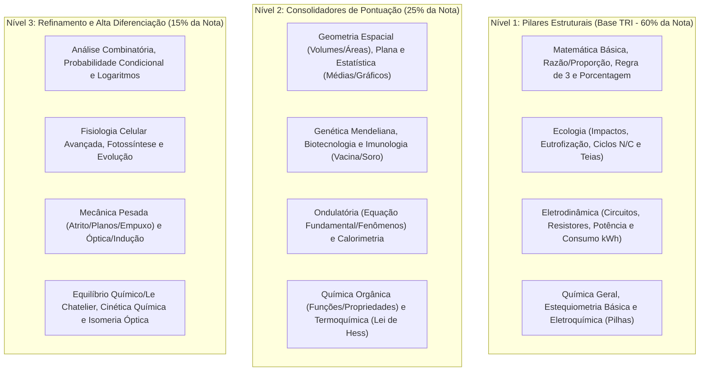

# RELATÓRIO ESTATÍSTICO CONSOLIDADO: PADRÕES E INCIDÊNCIA DO 2º DIA DO ENEM
## Matemática e suas Tecnologias | Ciências da Natureza e suas Tecnologias

> **Status:** Concluído — Matriz de Priorização Preparada para Cruzamento (Fase 2)  
> **Fontes e Bases Consolidadas:** Levantamentos históricos do SAS Educação (Raio-X do ENEM), Sistema de Ensino Poliedro, Bernoulli Educação, Plataforma Aprova Total, Professor Ferretto e matriz histórica oficial do INEP (2009–2024).  
> **Destino dos Arquivos:** `FINAL/RELATORIO_ESTATISTICO_ENEM_DIA_2.md`

---

## 1. VISÃO GERAL E ESTRATÉGIA TRI NO 2º DIA

O segundo dia do ENEM é caracterizado pela maior sobrecarga cognitiva e matemática da prova:
* **Matemática e suas Tecnologias:** 45 questões isoladas.
* **Ciências da Natureza e suas Tecnologias:** 45 questões divididas entre **Biologia (~15)**, **Física (~15)** e **Química (~15)**, com alta recorrência de questões interdisciplinares e contextualizadas em problemas socioambientais e tecnológicos.
* **Tempo Total:** 5 horas (300 minutos) para 90 questões e preenchimento de gabarito (~3 minutos por questão).

### Impacto na Teoria de Resposta ao Item (TRI):
1. **Consistência Pedagógica:** O algoritmo da TRI pune severamente o candidato que erra questões consideradas fáceis (baixo parâmetro de dificuldade $b$) e acerta questões difíceis (suspeita de acerto casual / "chute").
2. **Priorização Obrigatória:** A nota em Matemática tem a maior amplitude do exame (podendo ultrapassar 950–980 pontos com boa coerência). Em Ciências da Natureza, acertar os blocos conceituais clássicos de Ecologia, Eletrodinâmica básica e Química Geral sustenta a base da pontuação acima de 700–750 pontos.

---

## 2. MATEMÁTICA E SUAS TECNOLOGIAS (45 Questões)

### 2.1 Distribuição Histórica Percentual por Grande Frente

| Frente / Conteúdo | Incidência Média (%) | Questões Estimadas / Prova | Grau de Prioridade TRI |
| :--- | :---: | :---: | :---: |
| **Matemática Básica e Proporcionalidade** | **34% a 38%** | 15 a 17 questões | **CRUCIAL (Base TRI)** |
| **Geometria Espacial** | **11% a 13%** | 5 a 6 questões | **ALTA (Diferencial)** |
| **Estatística Básica** | **10% a 12%** | 4 a 6 questões | **CRUCIAL (Base TRI)** |
| **Geometria Plana** | **8% a 10%** | 3 a 5 questões | **ALTA** |
| **Funções (Afim, Quadrática, Exponencial/Log)** | **7% a 9%** | 3 a 4 questões | **MÉDIA-ALTA** |
| **Probabilidade** | **5% a 7%** | 2 a 3 questões | **MÉDIA** |
| **Análise Combinatória** | **4% a 5%** | 2 a 3 questões | **MÉDIA (Alto índice de erro)** |
| **Trigonometria e Geometria Analítica** | **3% a 5%** | 1 a 2 questões | **REFINAMENTO** |
| **Matemática Financeira** | **3% a 4%** | 1 a 2 questões | **ALTA (Contextualizada)** |

---

### 2.2 Tópicos de Alta Prioridade e Padrões de Cobrança

#### A. Matemática Básica e Proporcionalidade (A espinha dorsal da prova)
* **Razão e Proporção / Escalas:** Questões de conversão de escala cartográfica e arquitetônica ($\text{Escala linear} = d/D$; escala de áreas $= (d/D)^2$; escala de volumes $= (d/D)^3$). Altíssimo volume de questões diretas.
* **Regra de Três Simples e Composta:** Grandezas direta e inversamente proporcionais (ex: consumo de combustível, rendimento de máquinas, tempo de obra vs. operários).
* **Porcentagem e Variações Percentuais:** Aumentos e descontos sucessivos, cálculo de taxa real de crescimento, inflação e lucros sobre custo/venda.
* **Sistemas Métricos e Conversão de Unidades:** Conversões rápidas entre litros, decímetros cúbicos, metros cúbicos ($1\text{ m}^3 = 1000\text{ L}$), centímetros e milímetros, além de conversões de tempo (horas para segundos/minutos).

#### B. Geometria Espacial
* **Cálculo de Volumes e Áreas de Superfície:** Foco maciço em **cilindros retos**, **prismas retos** (paralelepípedo e base triangular/hexagonal), **cones** e **esferas**. Problemas clássicos de capacidade de reservatórios, caixas d'água, embalagens econômicas e dosagem de líquidos.
* **Visualização Espacial e Projeção Ortogonal:** Identificação da sombra projetada no solo, vistas ortogonais (frontal, lateral, superior) e planificação de sólidos geométricos. Não exige cálculos numéricos complexos, mas sim percepção tridimensional.
* **Poliedros:** Aplicação da Relação de Euler ($V - A + F = 2$) e contagem estrutural de arestas/vértices em prismas e poliedros truncados (como a bola de futebol / icosaedro truncado).

#### C. Estatística Básica
* **Interpretação de Gráficos e Tabelas:** Gráficos de barras, colunas duplas, setores (pizza) e linhas temporais.
* **Medidas de Tendência Central:** 
  * **Média aritmética simples e média ponderada** (cálculo de notas, consumo médio ponderado por peso).
  * **Mediana:** Procedimento padrão de ordenação em rol e busca do elemento central (ou média dos dois centrais se $N$ for par).
  * **Moda:** Elemento de maior frequência absoluta.
* **Medidas de Dispersão:** Desvio padrão e variância interpretados qualitativamente (regularidade, homogeneidade ou dispersão dos dados de um atleta, empresa ou produção).

#### D. Geometria Plana
* **Áreas de Figuras Planas:** Triângulos (fórmula clássica, fórmula de Herão e triângulo equilátero $\frac{L^2\sqrt{3}}{4}$), círculos e setores circulares, retângulos, trapézios e paralelogramos.
* **Teorema de Pitágoras e Trigonometria no Triângulo Retângulo:** Relações fundamentais de seno, cosseno e tangente (ângulos notáveis: 30°, 45°, 60°).
* **Semelhança de Triângulos e Teorema de Tales:** Aplicação em problemas de alturas inacessíveis, sombras e postes.

#### E. Funções e Modelagem Algébrica
* **Função Afim ($y = ax + b$):** Interpretação do coeficiente angular $a$ como taxa de variação (custo variável) e coeficiente linear $b$ como valor inicial fixo (bandeirada de táxi, taxa fixa de serviços).
* **Função Quadrática ($y = ax^2 + bx + c$):** Determinação de máximos e mínimos por meio das coordenadas do vértice ($x_v = -\frac{b}{2a}$, $y_v = -\frac{\Delta}{4a}$) em situações de lucro máximo, custo mínimo ou alcance de projéteis.
* **Funções Exponenciais e Logarítmicas:** Fenômenos de crescimento/decaimento exponencial (bactérias, radioatividade, escalas Richter e pH), quase sempre fornecendo as propriedades logarítmicas no enunciado.

#### F. Probabilidade e Análise Combinatória
* **Análise Combinatória:** Princípio Fundamental da Contagem (PFC), permutações com repetição (anagramas e sequências de passos) e combinação simples (formação de comissões, equipes ou agrupamentos sem ordem).
* **Probabilidade:** Razão $\frac{\text{casos favoráveis}}{\text{casos possíveis}}$, probabilidade da união de eventos ($P(A \cup B) = P(A) + P(B) - P(A \cap B)$) e probabilidade condicional com redução do espaço amostral.

---

## 3. BIOLOGIA (~15 Questões)

### 3.1 Distribuição Histórica Percentual por Tópico

| Tópico Principal | Incidência Média (%) | Status de Recorrência |
| :--- | :---: | :---: |
| **Ecologia** | **28% a 32%** | **LÍDER ABSOLUTA HISTÓRICA** |
| **Genética e Biologia Molecular** | **14% a 17%** | **ALTA** |
| **Citologia e Metabolismo Energético** | **12% a 15%** | **ALTA** |
| **Fisiologia Humana e Imunologia** | **10% a 13%** | **ALTA** |
| **Parasitologia e Doenças Humanas** | **8% a 10%** | **MÉDIA-ALTA** |
| **Evolução Biológica** | **7% a 9%** | **MÉDIA** |
| **Biotecnologia** | **6% a 8%** | **ALTA (Interdisciplinar)** |
| **Botânica e Reino Vegetal** | **4% a 6%** | **ESPECÍFICA** |

---

### 3.2 Tópicos de Alta Prioridade e Detalhamento Temático

#### A. Ecologia (Cerca de 1/3 da prova de Biologia)
1. **Impactos Ambientais Antrópicos:**
   * **Eutrofização:** Descarte de esgoto/fertilizantes $\rightarrow$ proliferação de algas $\rightarrow$ bloqueio de luz $\rightarrow$ morte de vegetais submersos $\rightarrow$ proliferação de decompositores aeróbios $\rightarrow$ depleção de $O_2$ dissolvido $\rightarrow$ anóxia e mortandade de peixes.
   * **Bioacumulação e Magnificação Trófica:** Acúmulo de metais pesados (mercúrio, chumbo) e pesticidas organoclorados (DDT), com concentração máxima nos níveis tróficos superiores (consumidores de topo).
   * **Aquecimento Global e Acidificação dos Oceanos:** Emissão de gases do efeito estufa ($CO_2$, $CH_4$) e dissolução de $CO_2$ na água formando ácido carbônico ($H_2CO_3$), prejudicando corais e organismos calcificados.
   * **Chuva Ácida e Espécies Exóticas Invasoras:** Proliferação sem predadores naturais e desequilíbrio de nichos ecológicos.
2. **Dinâmica Ecológica:**
   * **Fluxo de Energia e Cadeias/Teias Alimentares:** Fluxo unidirecional e decrescente ao longo dos níveis tróficos. Pirâmides de biomassa, números e energia (pirâmide de energia nunca é invertida).
   * **Ciclos Biogeoquímicos:** Especialmente o **Ciclo do Nitrogênio** (fixação por bactérias simbióticas *Rhizobium*, nitrificação via nitrosação e nitratação por bactérias quimiossintetizantes, e desnitrificação) e o **Ciclo do Carbono**.
   * **Relações Ecológicas:** Mutualismo, comensalismo, protocooperação, parasitismo, predação, competição interespecífica e intraespecífica.

#### B. Genética, Biologia Molecular e Biotecnologia
* **Leis de Mendel e Hereditariedade:** Primeira Lei (monoibridismo), Segunda Lei (segregação independente), heredogramas clássicos (identificação de padrões autossômicos dominantes/recessivos e ligados ao sexo).
* **Alelos Múltiplos e Tipagem Sanguínea:** Sistema ABO (aglutinogênios nas hemácias vs. aglutininas no plasma) e Fator Rh (eritroblastose fetal / doença hemolítica do recém-nascido).
* **Biotecnologia Aplicada:** Transgênicos (organismos geneticamente modificados com DNA de outra espécie) vs. Clonagem (indivíduos geneticamente idênticos), tecnologia do DNA recombinante, PCR (reação em cadeia da polimerase), eletroforese de DNA e terapia gênica / CRISPR-Cas9.

#### C. Citologia e Metabolismo Energético
* **Fotossíntese e Quimiossíntese:** Fase clara/fotoquímica (tilacoides, quebra da água liberando $O_2$, síntese de ATP e NADPH) e fase escura/química (estroma, ciclo de Calvin, fixação de $CO_2$).
* **Respiração Celular e Fermentação:** Balanço energético da glicólise, ciclo de Krebs e fosforilação oxidativa (cadeia respiratória nas cristas mitocondriais); fermentação láctica e alcoólica em processos industriais e musculares.
* **Membrana Plasmática e Transportes:** Osmose em células vegetais (túrgida, plasmolisada, deplasmolisada) e animais (crenação, hemólise); difusão simples, facilitada e transporte ativo ($Na^+/K^+$ com gasto de ATP).

#### D. Fisiologia Humana e Imunologia
* **Vacina vs. Soro:** Vacina = imunização ativa, profilática/preventiva, contém antígenos atenuados/inativados ou RNAm, gera células de memória imunológica; Soro = imunização passiva, terapêutica/curativa emergencial, contém anticorpos pré-formados, não gera memória de longo prazo.
* **Doenças Humanas e Agentes Etiológicos:**
  * Arboviroses transmitidas pelo *Aedes aegypti* (Dengue, Zika, Chikungunya e Febre Amarela).
  * Protozooses clássicas: Doença de Chagas (*Trypanosoma cruzi* via barbeiro), Malária (*Plasmodium* via mosquito-prego *Anopheles*), Leishmaniose.
  * Doenças bacterianas vs. virais (uso racional de antibióticos e seleção de cepas resistentes).

---

## 4. FÍSICA (~15 Questões)

### 4.1 Distribuição Histórica Percentual por Tópico

| Tópico Principal | Incidência Média (%) | Status de Recorrência |
| :--- | :---: | :---: |
| **Mecânica Clássica** | **26% a 30%** | **LÍDER EM VOLUME** |
| **Eletrodinâmica** | **21% a 24%** | **LÍDER EM REGULARIDADE** |
| **Ondulatória** | **14% a 16%** | **ALTA (Foco Conceitual)** |
| **Termologia / Termofísica** | **13% a 16%** | **ALTA** |
| **Óptica Geométrica** | **7% a 9%** | **MÉDIA** |
| **Hidrostática** | **5% a 7%** | **MÉDIA** |
| **Eletromagnetismo e Indução** | **4% a 6%** | **REFINAMENTO** |

---

### 4.2 Tópicos de Alta Prioridade e Detalhamento Temático

#### A. Eletrodinâmica (A queridinha do ENEM)
* **Circuitos Elétricos:** Associação de resistores em série ($R_{eq} = R_1 + R_2$, corrente constante) e em paralelo ($1/R_{eq} = 1/R_1 + 1/R_2$, d.d.p. constante); análise de curto-circuito (ponte de condutor nulo isolando elementos).
* **Potência e Consumo de Energia Elétrica:** Relações $P = U \cdot i = R \cdot i^2 = \frac{U^2}{R}$. Cálculo do consumo residencial: $E (\text{kWh}) = \frac{P (\text{W}) \cdot \Delta t (\text{h})}{1000}$. Leitura de faturas de eletricidade e impacto de aparelhos resistivos (chuveiros, ferros de passar).
* **Segurança Elétrica e Instrumentos:** Dimensionamento de fusíveis e disjuntores com base na corrente limite ($i = P/U$); ligação correta de amperímetros (em série, resistência nula ideal) e voltímetros (em paralelo, resistência infinita ideal).

#### B. Mecânica Clássica e Hidrostática
* **Conservação da Energia Mecânica:** Transformação entre energia cinética ($E_c = \frac{mv^2}{2}$), potencial gravitacional ($E_p = mgh$) e potencial elástica ($E_{el} = \frac{kx^2}{2}$); dissipação de energia por atrito e rendimento.
* **Dinâmica e Leis de Newton:** Aplicação de força resultante ($F_R = m \cdot a$), decomposição em planos inclinados, força de atrito estático e cinético, e dinâmica do movimento circular (força centrípeta $F_{cp} = \frac{mv^2}{R}$).
* **Cinemática Escalar e Gráfica:** Leitura gráfica de $s \times t$ e $v \times t$ (área sob a curva $v \times t$ numericamente igual à distância $\Delta s$), velocidade média e distância de frenagem.
* **Hidrostática:** Pressão hidrostática ($P = d \cdot g \cdot h$), Teorema de Pascal (prensas hidráulicas $\frac{F_1}{A_1} = \frac{F_2}{A_2}$) e Princípio de Arquimedes / Empuxo ($E = d_{liquido} \cdot V_{submerso} \cdot g$) na flutuação de corpos.

#### C. Ondulatória e Acústica
* **Equação Fundamental da Onda:** $v = \lambda \cdot f$. Relação de que a velocidade depende exclusivamente do meio de propagação, e a frequência é determinada pela fonte emissora.
* **Fenômenos Ondulatórios:**
  * **Refração:** Mudança de meio de propagação com alteração de velocidade e comprimento de onda, mantendo a frequência rigorosamente constante.
  * **Difração:** Capacidade da onda de contornar obstáculos (mais acentuada quando o tamanho do obstáculo é da ordem do comprimento de onda $\lambda$).
  * **Interferência e Ressonância:** Ondas estacionárias, cancelamento/reforço de ruídos e colapso por ressonância mecânica.
  * **Efeito Doppler:** Variação aparente da frequência devido ao movimento relativo entre fonte e observador (aproximação = frequência aparente mais alta/aguda; afastamento = mais baixa/grave).
* **Acústica e Qualidades Fisiológicas:** Altura (som grave vs. agudo $\rightarrow$ frequência), Intensidade (som forte vs. fraco $\rightarrow$ amplitude/energia) e Timbre (formato da onda sonora que permite distinguir instrumentos distintos tocando a mesma nota).

#### D. Termologia e Termodinâmica
* **Calorimetria:** Calor sensível ($Q = m \cdot c \cdot \Delta T$) vs. Calor latente de mudança de estado ($Q = m \cdot L$). Princípio da conservação nas trocas de calor isoladas ($\sum Q = 0$).
* **Processos de Transmissão de Calor:** Condução (sólidos, contato molecular direto), Convecção (líquidos e gases, correntes por diferença de densidade) e Irradiação (ondas eletromagnéticas no vácuo, painéis solares e garrafas térmicas).
* **Termodinâmica:** Primeira Lei ($\Delta U = Q - \tau$) e Segunda Lei (impossibilidade de rendimento 100% de máquinas térmicas, calor fluindo espontaneamente do corpo mais quente para o mais frio).

---

## 5. QUÍMICA (~15 Questões)

### 5.1 Distribuição Histórica Percentual por Tópico

| Tópico Principal | Incidência Média (%) | Status de Recorrência |
| :--- | :---: | :---: |
| **Físico-Química** | **28% a 32%** | **LÍDER EM CÁLCULOS** |
| **Química Geral e Inorgânica** | **25% a 28%** | **BASE ESTRUTURAL** |
| **Química Orgânica** | **19% a 23%** | **ALTA REGULARIDADE** |
| **Química Ambiental** | **10% a 13%** | **ALTA (Contextualizada)** |
| **Atomística e Ligações Químicas** | **6% a 8%** | **CONCEITUAL** |

---

### 5.2 Tópicos de Alta Prioridade e Detalhamento Temático

#### A. Físico-Química (Coração dos cálculos e processos)
* **Eletroquímica (Pilhas e Eletrólise):**
  * **Pilhas Galvânicas:** Oxidação no Ânodo (polo negativo, perde elétrons, corrói a placa) vs. Redução no Cátodo (polo positivo, ganha elétrons, deposita massa). Cálculo de d.d.p.: $\Delta E^0 = E^0_{red(maior)} - E^0_{red(menor)} > 0$ (processo espontâneo).
  * **Corrosão e Metal de Sacrifício:** Proteção de tubulações e cascos de navios utilizando metais com menor potencial de redução (maior potencial de oxidação, ex: Magnésio e Zinco protegendo o Ferro).
  * **Eletrólise:** Processo não espontâneo forçado por corrente contínua externa (galvanoplastia, purificação de cobre e produção de alumínio).
* **Termoquímica:**
  * Reações Exotérmicas ($\Delta H < 0$, liberação de calor) vs. Endotérmicas ($\Delta H > 0$, absorção).
  * Determinação de $\Delta H$ por **Lei de Hess** (soma algébrica de etapas), **Energias de Ligação** ($\Delta H = \sum E_{quebra(reagentes)} - \sum E_{formacao(produtos)}$) e **Entalpias Padrão de Formação**.
* **Cinética e Equilíbrio Químico:**
  * Fatores que alteram a velocidade da reação (superfície de contato, temperatura, concentração e presença de **catalisadores**, que diminuem a energia de ativação sem alterar o $\Delta H$ nem o rendimento final).
  * Princípio de Le Chatelier: Deslocamento do equilíbrio por variação de pressão (favorece o lado com menor volume gasoso), temperatura (aumento favorece sentido endotérmico) e concentração de reagentes/produtos.
* **Soluções e Concentrações:** Concentração comum (g/L), concentração em quantidade de matéria (mol/L), título, partes por milhão (ppm) em poluição de água/ar e cálculos de diluição ($C_1 \cdot V_1 = C_2 \cdot V_2$).

#### B. Química Geral e Estequiometria
* **Cálculos Estequiométricos Reais:** Aplicação das leis ponderais (Lavoisier e Proust), conversão estequiométrica com reagentes impuros ($\% \text{ pureza}$), rendimento percentual de reações e determinação de reagente limitante e em excesso.
* **Forças Intermoleculares e Ligações Químicas:** Ligações covalentes, iônicas e metálicas. Forças intermoleculares: Ligações de Hidrogênio (H ligado a F, O, N), dipolo permanente e dipolo induzido/London. Relação direta com ponto de ebulição e solubilidade ("semelhante dissolve semelhante").
* **Separação de Misturas:** Decantação, filtração, destilação simples e fracionada (refino do petróleo), flotação e centrifugação em estações de tratamento de água e esgoto (ETA / ETE).

#### C. Química Orgânica
* **Reconhecimento de Funções Orgânicas:** Álcoois, fenóis, aldeídos, cetonas, ácidos carboxílicos, ésteres, éteres, aminas e amidas em estruturas de fármacos, defensivos agrícolas e cosméticos.
* **Propriedades Físicas dos Compostos Orgânicos:** Polaridade da molécula, presença de grupos polares/apolares, solubilidade em solventes hidrofílicos vs. lipofílicos, e impacto na formação de sabões/detergentes (moléculas anfifílicas com cauda apolar e cabeça iônica polar).
* **Isomeria:** Isomeria plana (cadeia, posição, função) e espacial: isomeria geométrica (*cis-trans* em alcenos e ciclos) e isomeria óptica (presença de carbono quiral assimétrico).
* **Reações Orgânicas e Polímeros:** Reação de esterificação (ácido carboxílico + álcool $\rightarrow$ éster + água, base da síntese de biodiesel e aromas), saponificação, polímeros de adição e condensação (PET, polietileno, PVC).

#### D. Química Ambiental
* Gases de efeito estufa e fontes de emissão; óxidos ácidos causadores da chuva ácida ($SO_2$, $SO_3$, $NO_x$ gerando $H_2SO_4$ e $HNO_3$); destruição da camada de ozônio pelos CFCs; e tratamento químico de efluentes (floculação com sulfato de alumínio e cloração para desinfecção).

---

## 6. MATRIZ DE PRIORIZAÇÃO HIERÁRQUICA PARA A FASE 2
### (Cruzamento Direcionado aos 5 GB de Simulados em PDF)

Para guiar a extração e classificação de questões nos simulados SAS, Bernoulli, Poliedro e APEIRON disponíveis no workspace, a matriz de ataque pedagógico fica organizada em três níveis de prioridade:

---

## 7. PRONTIDÃO PARA A FASE 2

O relatório estatístico encontra-se finalizado e salvo em `FINAL/RELATORIO_ESTATISTICO_ENEM_DIA_2.md`.  
A base teórica, os percentuais históricos consolidados e a taxonomia de tópicos estão prontos para alimentar os scripts de indexação, leitura de PDFs e separação das questões dos simulados SAS, Bernoulli e Poliedro.

Aguardando o seu sinal para iniciar a **Fase 2**!

