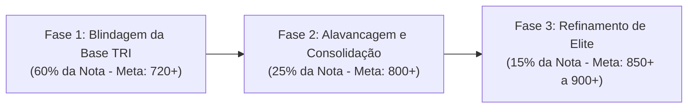

# TRILHA TÁTICA DE ESTUDOS E CRONOGRAMA DE SIMULADOS: 2º DIA DO ENEM
## Metodologia de Alavancagem TRI e Cronograma Operacional Baseado no Acervo

> **Status:** Concluído — Guia de Execução Tática Pronto para Uso  
> **Destino do Arquivo:** `FINAL/TRILHA_ESTUDOS_CRONOGRAMA_DIA_2.md`  
> **Base:** Acervo de 5.5 GB categorizado em `FINAL/CATALOGO_GERAL_ACERVO_ENEM_DIA_2.md` e `FINAL/INDICE_TEMATICO_SIMULADOS_DIA_2.md`  

---

## 1. DIRETRIZES FUNDAMENTAIS PARA O 2º DIA DO ENEM

O segundo dia do ENEM é uma maratona de resistência física, cognitiva e emocional. São **90 questões** complexas em **300 minutos** (~3 minutos e 20 segundos por questão, incluindo o cartão de respostas):

1. **A Regra de Ouro da TRI:**
   * Não tente resolver a prova na ordem numérica linear (1 a 90 ou 91 a 180).
   * O algoritmo da TRI pune com perda drástica de nota o candidato que acerta itens difíceis (ex: logaritmos ou circuitos complexos de pontes) mas erra itens fáceis (ex: regra de três, leitura direta de gráfico de colunas ou conceito básico de fotossíntese).
2. **O Protocolo das Três Passadas no Bloco de Prova:**
   * **Passada 1 (Minutos 0 a 100):** Varredura completa. Resolva apenas as questões fáceis, diretas e conceituais (Matemática Básica, Estatística de leitura, Ecologia e Química Geral descritiva). Deixe assinaladas as médias e pule imediatamente as difíceis.
   * **Passada 2 (Minutos 100 a 230):** Resolução das questões médias que exigem desenvolvimento algébrico intermediário (Geometria Espacial com cálculos de volume, Estequiometria clássica, Ondulatória e Eletrodinâmica de resistores em série/paralelo).
   * **Passada 3 (Minutos 230 a 275):** Ataque cirúrgico às questões de alto nível de exigência (Análise Combinatória com restrições, Cinética/Equilíbrio avançado, Mecânica pesada de atrito e planos inclinados).
   * **Preenchimento do Gabarito (Minutos 275 a 300):** 25 minutos exclusivos para transposição calma e metódica, sem risco de inversão de linhas.

---

## 2. A TRILHA EM 3 FASES DE ALAVANCAGEM TRI

### FASE 1: BLINDAGEM DA BASE TRI (Semanas 1 a 4)
* **Objetivo:** Erro zero nas questões classificadas como fáceis pela matriz pedagógica.
* **Foco de Conteúdos:**
  * **Matemática:** Matemática Básica e Proporcionalidade (M1) e Estatística Básica (M3).
  * **Biologia:** Ecologia e Meio Ambiente (B1).
  * **Física:** Eletrodinâmica Básica (F1) e Calorimetria Sensível (F4).
  * **Química:** Química Geral, Separação de Misturas e Pilhas Galvânicas (Q1/Q2).
* **Bateria Prática Obrigatória (Acervo Workspace):**
  1. `ENEM/2021/ENEM 2021 DIA 2.pdf` (Prova limpa) calibrado com o gabarito oficial.
  2. `POLIEDRO/2024/2024_1_poliedro_enem_2_dia_prova.pdf` (Prova) e estudo reverso linha a linha em `POLIEDRO/2024/1º Simulado Enem 2024 - 2º Dia - Resolução.pdf`.
  3. `_ENEM_DIA_2_BRUTO/1241-19_AP2_CNST-MST_3SERIE_1ETAPA.pdf` (SAS 90Q) com correção em `_ENEM_DIA_2_BRUTO/1242-19_RESOLUCAO_AP2_CNST-MST_3SERIE_1ETAPA.pdf`.

### FASE 2: ALAVANCAGEM E CONSOLIDAÇÃO (Semanas 5 a 8)
* **Objetivo:** Dominar as questões de dificuldade média que elevam a nota para além do corte da maioria das universidades públicas e cursos concorridos.
* **Foco de Conteúdos:**
  * **Matemática:** Geometria Espacial (M2), Geometria Plana (M4) e Funções Afim/Quadrática (M5).
  * **Biologia:** Genética Mendeliana e Biotecnologia (B2) e Fisiologia/Imunologia (B4).
  * **Física:** Ondulatória/Fenômenos (F3) e Mecânica (Energia e Leis de Newton - F2).
  * **Química:** Química Orgânica (Funções, Isomeria Plana, Polímeros - Q3) e Termoquímica/Lei de Hess (Q1).
* **Bateria Prática Obrigatória (Acervo Workspace):**
  1. `BERNOULLI-20261110T151947Z-1-001/BERNOULLI/2019/1º conjunto/Simulado_Enem_2019_Gabarito_e_Questoes_comentadas_Prova_II.pdf` (Bernoulli Simulado 1 Completo).
  2. `BERNOULLI-20261110T151947Z-1-001/BERNOULLI/2019/2º conjunto/2_conj_2019_Gabarito_Questao_comentada_Prova_II.pdf` (Bernoulli Simulado 2 Completo).
  3. `POLIEDRO/2024/2º Simulado Enem 2024 - 2º Dia - Resolução.pdf` (Poliedro Simulado 2 Completo).
  4. `POLIEDRO/2024/3º Simulado Enem 2024 - 2º Dia - Resolução.pdf` (Poliedro Simulado 3 Completo).
  5. `_ENEM_DIA_2_BRUTO/1373-20 - AP2 DE CNST-MST - 3a SERIE - 1a ETAPA _ WILL.pdf` corrigido com `_ENEM_DIA_2_BRUTO/1378-20 - RESOLUCAO - AP2 DE CNST-MST - 3a SERIE - 1a ETAPA _ WILL.pdf`.

### FASE 3: REFINAMENTO DE ELITE E DIFERENCIAÇÃO (Semanas 9 a 12)
* **Objetivo:** Acertar os itens de alto poder de discriminação pedagógica para alcançar 800+ em Natureza e 900+ em Matemática (competitividade ampla para Medicina nas Federais).
* **Foco de Conteúdos:**
  * **Matemática:** Análise Combinatória (M6), Probabilidade Condicional (M6) e Modelagem Logarítmica (M5).
  * **Biologia:** Citologia/Metabolismo Energético Detalhado (B3) e Biotecnologia de Engenharia Gênica (B2).
  * **Física:** Eletrodinâmica de Instrumentos e Pontes (F1), Hidrostática de Empuxo (F2) e Ondulatória/Efeito Doppler (F3).
  * **Química:** Equilíbrio Químico/Le Chatelier (Q1), Cinética Química (Q1), Estequiometria com Pureza/Rendimento (Q2) e Isomeria Óptica (Q3).
* **Bateria Prática de Choque (Acervo Workspace):**
  1. `POLIEDRO/2024/4º Simulado Enem 2024 - 2º Dia - Resolução.pdf`.
  2. `POLIEDRO/2024/5º Simulado Enem 2024 - 2º Dia - Resolução.pdf`.
  3. `BERNOULLI-20261110T151947Z-1-001/BERNOULLI/2019/4º conjunto/Simulado_Enem_2019_Gabarito_e_Questoes_comentadas_Prova_II.pdf`.
  4. `BERNOULLI-20261110T151947Z-1-001/BERNOULLI/2019/5º conjunto/Simulado_Enem_2019_Gabarito_e_Questoes_comentadas_Prova_II.pdf`.
  5. `_ENEM_DIA_2_BRUTO/1° BERNOULLI EXTRA 2026 - D2.pdf` e `_ENEM_DIA_2_BRUTO/1º SIMULADO SAS ENEM - 2026 -  D2 - AMARELO.pdf`.
  6. `APEIRON-20261110T152018Z-1-001/APEIRON/2º/A2GCD2 (Oficial)-1.pdf` (Resolução Passo a Passo Apeiron 2026).
  7. Provas Oficiais de Calibração Final: `ENEM/2024/ENEM 2024 DIA 2.pdf` e `ENEM/2025/enem-2025-2-dia-caderno-amarelo.pdf`.

---

## 3. PROTOCOLO OPERACIONAL DO CADERNO DE ERROS

A diferença entre estagnar em 650 pontos e ultrapassar 800 pontos não está em fazer centenas de simulados sem critério, mas na **qualidade do pós-prova**:

1. **Classificação do Erro em 4 Quadrantes:**
   * **Erro por Interpretação / Atenção:** O candidato sabia o conceito, mas não prestou atenção ao comando da questão (ex: pediu diâmetro e usou raio, pediu km/h e respondeu em m/s).
   * **Erro Algébrico / Contas:** Erro em conta de multiplicação, divisão decimal ou simplificação de frações sob pressão de tempo.
   * **Erro por Lacuna Teórica:** O candidato não lembrava da fórmula, da relação ecológica ou do conceito de polaridade.
   * **Erro por Estratégia / Tempo:** O candidato gastou 8 minutos em uma questão difícil e teve que chutar questões fáceis no final.
2. **Ciclo de Correção Ativa:**
   * Nunca apenas leia o gabarito. Pegue uma folha em branco e reescreva a resolução da questão errada do início ao fim sem olhar a resposta.
   * Se o erro foi lacuna teórica, revise o tópico correspondente na seção temática de `FINAL/INDICE_TEMATICO_SIMULADOS_DIA_2.md` e resolva 3 questões adicionais do mesmo código.